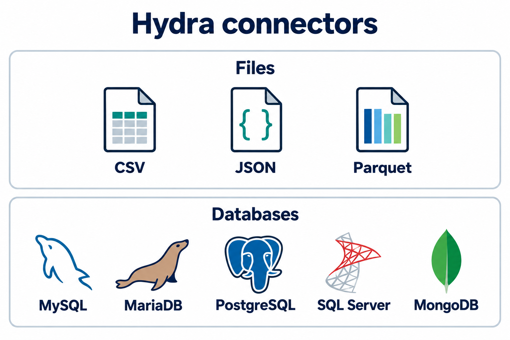
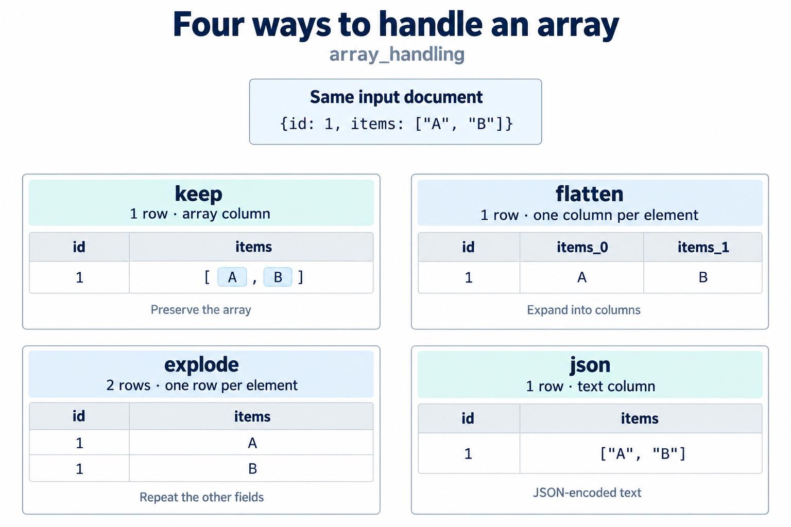
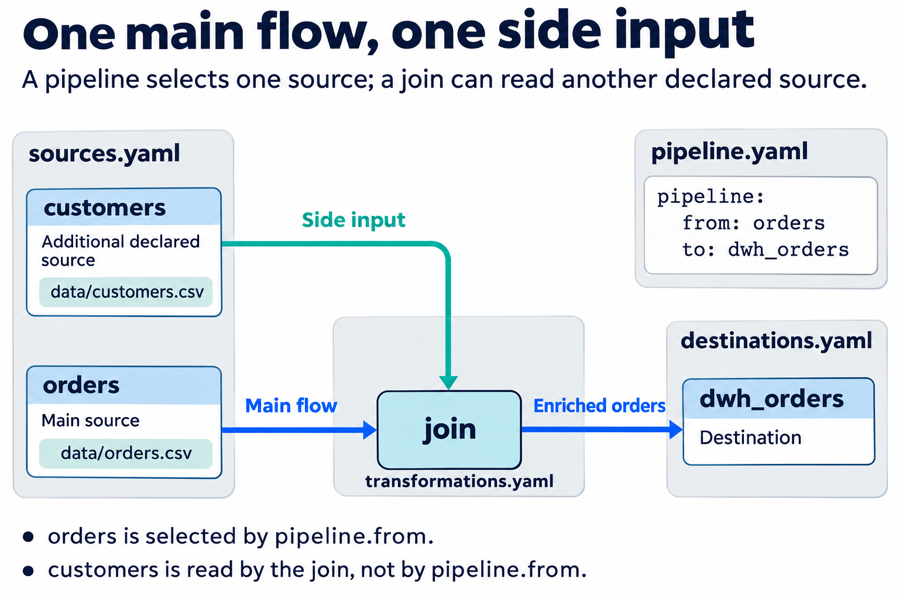

<!-- Hydra DSL White Paper — Chapter 2 (part 1): Jobs — Overview, Sources, Destinations, Pipeline
     DSL format version: 1.0 · Hydra 0.16.0
     Sources: internal/parser/{source,destination,pipeline}.py, internal/connector/registry.py,
     internal/connector/{csv,json,parquet,base_db,sqlserver}_connector.py,
     plugins/connectors/mongodb/connector.py, internal/schema/{descriptor,policies}.py,
     cli/hdrctl.py (_JOB_FILE_ALIASES), pyproject.toml (extras) -->

# Hydra DSL - Jobs

A **job** moves data from one place to another and applies transformations when it needs before loading data into their destinations. A job simply a folder with up to four files:

| File                   | Required | Answers the question                  |
| ---------------------- | -------- | ------------------------------------- |
| `sources.yaml`         | Yes      | Where does the data come from?        |
| `destinations.yaml`    | Yes      | Where does the data go?               |
| `pipeline.yaml`        | Yes      | Which source feeds which destination? |
| `transformations.yaml` | No       | What happens to the data on the way?  |

> **[FIGURE fig-02-01 · diagram]** Anatomy of a job: source (`sources.yaml`) → extract → transformations (`transformations.yaml`) → load → destination (`destinations.yaml`), with `pipeline.yaml` drawn as the bracket that links `from` to `to`.

## Rules for jobs

- A job folder must contain `sources.yaml`, `destinations.yaml` and `pipeline.yaml`. `.yml` is also accepted.
- Without `transformations.yaml`, the data is copied as is.
- Each source and destination has an **id** (the key under `sources:` or `destinations:`). `pipeline.yaml` uses these ids.
- A job reads **one** main source and writes to **one** destination. Other declared sources can be used by `join`, `merge` or `union`.
- Relative file paths are resolved from the job folder.

---

# Hydra DSL - Sources

A source tells Hydra **what to read** and **how to connect**.

## Syntax

```yaml
version: "1.0"
sources:
  <source_id>:
    type: <connector type>
    connection:
      <connection keys>
    extract:
      <what to read>
```

| Key          | Required | Description                                   |
| ------------ | -------- | --------------------------------------------- |
| `type`       | Yes      | Connector type (see the table below)          |
| `connection` | No       | How to connect. `{}` for local files          |
| `extract`    | Yes      | What to read                                  |
| `schema`     | No       | Expected structure of the documents (MongoDB) |

## Rules for sources

- `sources.yaml` must declare **at least one** source.
- `type` is not case sensitive: `CSV` and `csv` are the same.
- `extract` must define `table`, `query` or `collection`.
- `extract.batch_size` is the number of rows read at a time. Default `10000`, minimum `10`.

## Connector types



| `type`                           | Read        | Write | Install                                            |
| -------------------------------- | ----------- | ----- | -------------------------------------------------- |
| `csv`                            | ✔           | ✔     | built in                                           |
| `json`                           | ✔           | –     | built in                                           |
| `parquet`                        | ✔           | ✔     | `pip install "hydra-etl[parquet]"`                 |
| `mysql`, `mariadb`               | ✔           | ✔     | `pip install "hydra-etl[mysql]"`                   |
| `postgresql`, `postgres`         | ✔           | ✔     | `pip install "hydra-etl[postgres]"`                |
| `sqlserver`, `mssql`             | ✔           | ✔     | `pip install "hydra-etl[mssql]"`                   |
| `mongodb`                        | ✔           | ✔     | `pip install "hydra-etl[mongodb]"`                 |
| `sqlite`                         | ✔           | ✔     | built in (Hydra 0.20+)                             |
| `snowflake`                      | ✔           | –     | `pip install "hydra-etl[snowflake]"` (Hydra 0.20+) |
| `postgresql_cdc`, `postgres_cdc` | ✔ (changes) | –     | `pip install "hydra-etl[postgres]"` (Hydra 0.20+)  |

An unknown type stops the job with the list of supported types:

```
Connector 'src': unknown type 'excel'. Supported types: csv, json, mariadb, ...
```

## The `extract` block

| Key          | Used with     | Description                                   |
| ------------ | ------------- | --------------------------------------------- |
| `table`      | all           | File path, SQL table name                     |
| `query`      | SQL databases | A SQL `SELECT` statement                      |
| `collection` | MongoDB       | Collection name                               |
| `filter`     | MongoDB       | Query filter, as a mapping                    |
| `limit`      | MongoDB       | Maximum number of documents to read           |
| `batch_size` | all           | Rows per batch. Default `10000`, minimum `10` |

---

## CSV source

### Connection keys

| Key              | Default        | Description                    |
| ---------------- | -------------- | ------------------------------ |
| `base_path`      | the job folder | Folder used to resolve `table` (see Example 3) |
| `delimiter`      | `,`            | One character                  |
| `quotechar`      | `"`            | One character                  |
| `encoding`       | `utf-8`        | File encoding                  |
| `lineterminator` | `\n`           | End of line                    |
| `strict_schema`  | `false`        | Check the columns strictly     |

### Example 1: minimal

```yaml
version: "1.0"
sources:
  orders:
    type: csv
    connection: {}
    extract:
      table: data/orders.csv
```

`connection: {}` means: all defaults. The file is read from `<job folder>/data/orders.csv`.

**Hands on lab:** [**Read CSV files of all shapes | Killercoda**](https://killercoda.com/hydra-etl/scenario/08-read-csv-files-of-all-shapes) 


### Example 2: semicolon-separated, Latin-1 file

```yaml
version: "1.0"
sources:
  orders_fr:
    type: csv
    connection:
      delimiter: ";"
      encoding: latin-1
    extract:
      table: data/commandes.csv
      batch_size: 50000
```

<!-- REVIEW (décision H) : extract.limit est accepté pour tous les types mais n'est
     appliqué que par MongoDB ; ignoré en silence ailleurs (CSV, SQL…). Le documenter
     comme MongoDB seulement, ou l'implémenter partout ? -->

### Example 3: files kept elsewhere (`base_path`)

Without `base_path`, `table` is read from the job folder. `base_path` sets another folder:

```yaml
version: "1.0"
sources:
  supplier:
    type: csv
    connection:
      base_path: imports/supplier     # relative: from the project root
    extract:
      table: products.csv
```

| `base_path`                         | Folder used                                                    |
| ----------------------------------- | -------------------------------------------------------------- |
| absent                              | the job folder                                                 |
| relative (`imports/supplier`)       | from the project root, the folder that holds `.hydra/`; from the job folder when the job is not in a project |
| absolute (`D:/exports`, `\\server\share`) | that folder, as written                                   |
| `"{{ env:DATA_DIR }}"`              | a folder that changes from one machine to the next             |

The data can be anywhere: `data/` is only a convention. A relative `base_path` gives every job the same anchor, however deep the job is, and a job moved to another folder keeps working.

Before 0.20.1, a relative `base_path` was read from the folder `hdrctl` was started from. A job that still relies on that rule keeps working, with a warning in the log.

---

## JSON source

Reads `.json` (an array or an object) and JSON Lines files (`.jsonl`, `.ndjson`). Nested objects are flattened into columns.

```yaml
version: "1.0"
sources:
  users:
    type: json
    connection: {}
    extract:
      table: data/users.json
```

```yaml
# JSON Lines: one object per line
sources:
  events:
    type: json
    connection: {}
    extract:
      table: logs/events.jsonl
```

> JSON is read-only. To write JSON, use another destination type.

---

## Parquet source

```yaml
version: "1.0"
sources:
  sales:
    type: parquet
    connection: {}
    extract:
      table: data/sales.parquet
```

---

## SQL database sources

MySQL, MariaDB, PostgreSQL and SQL Server share the same shape.

### Connection keys

| Key                        | MySQL / MariaDB | PostgreSQL | SQL Server                          |
| -------------------------- | --------------- | ---------- | ----------------------------------- |
| `host`                     | ✔               | ✔          | ✔                                   |
| `port`                     | ✔               | ✔          | ✔                                   |
| `user`                     | ✔               | ✔          | ✔                                   |
| `password`                 | ✔               | ✔          | ✔                                   |
| `database`                 | ✔               | ✔          | ✔                                   |
| `schema`                   | –               | ✔          | ✔                                   |
| `instance`                 | –               | –          | ✔ named instance, e.g. `SQLEXPRESS` |
| `tds_version`              | –               | –          | ✔ protocol version                  |
| `login_timeout`, `timeout` | –               | –          | ✔ seconds                           |

### Example 1: read a whole table (MySQL)

```yaml
version: "1.0"
sources:
  customers:
    type: mysql
    connection:
      host: localhost
      port: 3306
      user: etl
      password: ${SECRET:MYSQL_PASSWORD}
      database: shop
    extract:
      table: customers
```

> Never write a password in clear. `${SECRET:NAME}` is explained in *Parameters and Secrets*.

### Example 2: read with a SQL query (PostgreSQL)

```yaml
version: "1.0"
sources:
  recent_orders:
    type: postgresql
    connection:
      host: db.internal
      port: 5432
      user: etl
      password: ${SECRET:PG_PASSWORD}
      database: sales
      schema: public
    extract:
      query: |
        SELECT id, customer_id, amount, created_at
        FROM orders
        WHERE created_at >= CURRENT_DATE - INTERVAL '7 days'
```

`query` and `table` are alternatives: use one or the other.

### Example 3: SQL Server named instance

```yaml
version: "1.0"
sources:
  erp:
    type: sqlserver
    connection:
      host: SRV-ERP
      instance: SQLEXPRESS
      user: etl
      password: ${SECRET:MSSQL_PASSWORD}
      database: ERP
      schema: dbo
    extract:
      table: Invoices
```

`host: SRV-ERP\SQLEXPRESS` is accepted too.

**[LAB lab-02-02 · Killercoda]** **[Read from a SQL database]([9. Read from a SQL database | Hydra ETL | Killercoda](https://killercoda.com/hydra-etl/scenario/09-read-from-a-sql-database))** 


 A MySQL and a PostgreSQL server are running. Read a whole table with `table`, then only the last 7 days with `query`.

---

## SQLite source and destination

*Hydra 0.20+.* SQLite is part of Python: nothing to install, no server. `connection.path` is the database file, relative to the job folder.

```yaml
sources:
  app:
    type: sqlite
    connection:
      path: ../../data/app.db
    extract:
      table: orders                 # or query: "SELECT ..."
```

```yaml
destinations:
  warehouse:
    type: sqlite
    connection:
      path: ../../outputs/warehouse.db
    load:
      table: orders
      mode: upsert                  # append | replace | upsert
      key: [order_id]
```

- A source file that does not exist is an error; it is never created by a read.
- A destination file and table are created at the first batch, with types taken from the data (`INTEGER`, `REAL`, `TEXT`, `BLOB`). In `upsert`, the key becomes the primary key.
- `upsert` on an existing table needs a primary key or a unique index on exactly the `key` columns; the error gives the `CREATE UNIQUE INDEX` to run.
- All-or-nothing by default in the three modes: one transaction for the job, table creation included. `load.atomic: false` commits batch by batch.
- `rollback: true` undoes a SQLite load like the other databases.
- The database uses the WAL journal, so a job can read one table while it writes another in the same file.

---

## Snowflake source

*Hydra 0.20+, read-only.* `pip install "hydra-etl[snowflake]"`.

```yaml
sources:
  snowflake_orders:
    type: snowflake
    connection:
      account: "{{ env:SNOWFLAKE_ACCOUNT }}"            # ORGNAME-ACCOUNTNAME, or xy12345.eu-central-2.aws
      user: "{{ env:SNOWFLAKE_USER }}"
      private_key_file: "{{ env:SNOWFLAKE_PRIVATE_KEY_FILE }}"   # key pair; or password
      warehouse: COMPUTE_WH
      database: SALES
      schema: PUBLIC
      column_case: lower        # ORDER_ID -> order_id
    extract:
      table: ORDERS             # or query: "SELECT ..."
```

### Connection keys

| Key                                       | Description                                                                                                                                                    |
| ----------------------------------------- | -------------------------------------------------------------------------------------------------------------------------------------------------------------- |
| `account`                                 | Account identifier (`ORGNAME-ACCOUNTNAME`) or locator with its region (`xy12345.eu-central-2.aws`), without `https://` or `.snowflakecomputing.com`. Required. |
| `user`                                    | Snowflake user, ideally a service user that can only read. Required.                                                                                           |
| `private_key_file`                        | Private key (PKCS#8, `.p8`) for key-pair authentication, recommended. `private_key_file_pwd` if the key is encrypted.                                          |
| `password`                                | Password, if no key pair.                                                                                                                                      |
| `warehouse`, `database`, `schema`, `role` | Where the queries run.                                                                                                                                         |
| `column_case`                             | `preserve` (default) or `lower`. Two columns that only differ by case are refused before any row is read.                                                      |
| `json`                                    | `parse` (default): `VARIANT`, `OBJECT`, `ARRAY` become JSON values; `text`: the JSON text.                                                                     |

### Types

| Snowflake                       | Value read by Hydra                | PostgreSQL column created                                                     |
| ------------------------------- | ---------------------------------- | ----------------------------------------------------------------------------- |
| `NUMBER(p,0)`                   | exact integer, even beyond 64 bits | `bigint` (`numeric` if the first batch already holds integers beyond 64 bits) |
| `NUMBER(p,s)`                   | exact decimal                      | `numeric`                                                                     |
| `FLOAT`                         | float                              | `double precision`                                                            |
| `DATE`                          | date                               | `date`                                                                        |
| `TIMESTAMP_NTZ`                 | timestamp without time zone        | `timestamp`                                                                   |
| `TIMESTAMP_TZ`, `TIMESTAMP_LTZ` | timestamp with its time zone       | `timestamptz`                                                                 |
| `VARIANT`, `OBJECT`, `ARRAY`    | JSON value                         | `jsonb`                                                                       |

- `extract.query` must start with `SELECT`, `WITH`, `SHOW` or `DESCRIBE`: the source is read-only, and Snowflake cannot be a destination.
- Every query is tagged `hydra-etl` (`QUERY_TAG`), so it can be found in Snowflake's query history.
- A PostgreSQL column that already exists keeps its type. If a value does not fit (an integer too large for a `bigint`), the batch is refused before it is written, with the `ALTER TABLE` to run; with `atomic: true`, the destination stays as it was.

Example: `examples/snowflake-to-postgres` in the Hydra ETL repository, with a local Snowflake emulator to try it without an account.

---

## PostgreSQL CDC source

*Hydra 0.20+.* Reads the changes of a table (inserts, updates, deletes) through PostgreSQL's logical replication, in the order of the transactions. Written to a PostgreSQL destination in `upsert`, they keep a mirror of the table up to date.

```yaml
sources:
  order_changes:
    type: postgresql_cdc
    connection:
      host: "{{ env:PG_HOST }}"
      port: 5432
      user: "{{ env:PG_USER }}"          # role with REPLICATION
      password: "{{ env:PG_PASSWORD }}"
      database: shop
      slot: hydra_orders                 # created at the first run
      publication: hydra_orders          # created at the first run
    extract:
      table: public.orders
```

```yaml
destinations:
  mirror:
    type: postgresql
    connection:
      host: "{{ env:PG_HOST }}"
      user: "{{ env:PG_USER }}"
      password: "{{ env:PG_PASSWORD }}"
      database: analytics
    load:
      table: orders
      mode: upsert
      key: [order_id]
      atomic: true
```

### Connection keys

| Key                                            | Description                                                                                          |
| ---------------------------------------------- | ---------------------------------------------------------------------------------------------------- |
| `host`, `port`, `user`, `password`, `database` | As for a PostgreSQL source. The user needs the `REPLICATION` attribute.                              |
| `slot`                                         | Logical replication slot, one per job: lowercase letters, digits and `_`.                            |
| `publication`                                  | Publication that contains the table.                                                                 |
| `create`                                       | `true` (default): create the slot and the publication if they are missing. `false`: they must exist. |
| `snapshot`                                     | `true` (default): the first run copies the whole table, then reads the changes.                      |
| `lag_warning_mb`                               | `1024` (default): warn when the slot retains more WAL than this, or has less than this left before `max_slot_wal_keep_size`. `0`: never warn. |

### How it works

1. **First run**: Hydra creates the publication and the slot, then reads the whole table.
2. **Next runs**: only the changes since the last successful run.
3. **Each row** carries the table's columns plus `_op` (`snapshot`, `insert`, `update`, `delete`), `_lsn` (position in the write-ahead log) and `_commit_time`.
4. **In the destination**, in `upsert`: the last change of each key wins, deletes are applied by key, and `_op`, `_lsn`, `_commit_time` are not written. In `append`, every change is written with its three columns: a log of the changes.
5. **Confirmation**: the changes are read without being consumed. The slot only moves on after the destination has published. A failed load reads the same changes again at the next run: nothing is lost, and the upsert applies them without duplicates.

### Requirements and limits

- `wal_level = logical` on the server (`ALTER SYSTEM SET wal_level = logical;` then a restart), PostgreSQL 11 or later.
- The source table needs a primary key, so that updates and deletes are applied by key.
- A slot keeps the server's write-ahead log until its changes are read. Drop a slot that is no longer used: `SELECT pg_drop_replication_slot('hydra_orders');`.
- **While loads keep failing, the slot does not move and the server keeps its WAL.** Before each run, Hydra reads the slot (`pg_replication_slots`: retained WAL, `wal_status`, `safe_wal_size`) and warns above `lag_warning_mb`. Set `max_slot_wal_keep_size` (PostgreSQL 13+) to cap the WAL a slot can hold: the disk is protected, but a slot that goes past it is invalidated (`wal_status = lost`).
- **An invalidated slot makes the run fail**, with the steps to rebuild the mirror: drop the slot, empty the destination table, run again (new slot, full copy). Hydra never goes on with a gap in the changes.
- A workflow with `rollback: true` cannot use a CDC source: the slot is confirmed at the end of the job and cannot be moved back. Use `load.atomic: true`.

Example: `examples/postgres-cdc-mirror` in the Hydra ETL repository: first copy, a day of changes, then a failure in the middle of the load that loses nothing.

---

## MongoDB source

```yaml
version: "1.0"
sources:
  paid_orders:
    type: mongodb
    connection:
      uri: mongodb://localhost:27017
      database: shop
    extract:
      collection: orders
      filter:
        status: paid
      limit: 1000
```

Instead of `uri`, you can give `host`, `port`, `username` and `password`.

**[[GITHUB gh-02-01 · example] mongodb_schema]([bejaouibechir.github.io/codes/02-jobs-part1/mongodb_schema at main · bejaouibechir/bejaouibechir.github.io · GitHub](https://github.com/bejaouibechir/bejaouibechir.github.io/tree/main/codes/02-jobs-part1/mongodb_schema))**


erreur du moteur à corriger ici

Défaut — Politiques de dérive MongoDB inopérantes

**Version testée :** Hydra ETL 0.16.0  
**Impact :** perte silencieuse des nouveaux champs et absence d’arrêt avec `drift_policy: fail`.

## Reproduction

La collection contient 102 documents :

- Les 100 premiers : `_id`, `customer`, `amount`.

- Les deux suivants ajoutent `sales_channel`, avec les valeurs `web` et `store`.

Configuration : `mode: infer_strict`, `sample_size: 100`. Répéter avec `drift_policy: warn`, `fail`, puis `adapt`.

| Politique | Résultat attendu                               | Résultat constaté               |
| --------- | ---------------------------------------------- | ------------------------------- |
| `warn`    | Continuer avec un avertissement de dérive      | 102 lignes, aucun avertissement |
| `fail`    | Arrêter avec une erreur de dérive              | 102 lignes, aucune erreur       |
| `adapt`   | Étendre le schéma et conserver `sales_channel` | 102 lignes, nouveau champ perdu |

**Le champ** `**sales_channel**` **est perdu dans les trois cas.**

## Deux causes identifiées

1. **Le schéma n’atteint pas le connecteur.**  
   Dans `hydra_etl/internal/runner/executor.py`, `JobExecutor._build_connector()` transmet `connection` et `extract`, mais omet `definition.schema`.

2. **L’extraction ne gère pas la dérive.**  
   Dans `hydra_etl/plugins/connectors/mongodb/connector.py`, `extract_batches()` normalise les documents sans déclencher leur validation ni adapter le schéma. Les champs inconnus disparaissent pendant la normalisation. Fournir directement le schéma au connecteur reproduit donc encore le défaut.

## Correction nécessaire

- Transmettre intégralement le bloc `schema` au connecteur.

- Détecter les changements **avant la normalisation**.

- Appliquer réellement `warn`, `fail` et `adapt`.

- Pour `adapt`, actualiser le schéma, le normaliseur et la sortie afin de conserver les nouveaux champs.

- Ajouter un test de régression vérifiant les trois comportements et les valeurs conservées.

**Limite de la vérification :** défaut reproduit avec le vrai moteur installé et un curseur MongoDB en mémoire. Le transfert complet avec un serveur MongoDB reste à tester. Aucun fichier du moteur n’a été modifié.

   |

   v

> **[LAB lab-02-03 · Killercoda]** **MongoDB documents and schema drift** — Read a collection whose documents differ, then compare `drift_policy: warn`, `fail` and `adapt`.

### The schema block

MongoDB documents have no fixed structure. The optional `schema` block tells Hydra which fields to expect and what to do when the data differs.

```yaml
sources:
  orders:
    type: mongodb
    connection:
      uri: mongodb://localhost:27017
      database: shop
    extract:
      collection: orders
    schema:
      mode: hybrid
      drift_policy: warn
      validation_policy: best_effort
      sample_size: 200
      fields:
        - name: order_id
          path: _id
          type: string
          required: true
        - name: customer_name
          path: customer.name
          type: string
        - name: items
          type: array
          array_handling: explode
```

| Key                 | Values                                                                                                                                                                     | Default       |
| ------------------- | -------------------------------------------------------------------------------------------------------------------------------------------------------------------------- | ------------- |
| `mode`              | `auto` (infer everything) · `manual` (only the declared fields) · `infer_strict` (infer from a sample, then enforce) · `hybrid` (declared fields + inference for the rest) | `auto`        |
| `drift_policy`      | `fail` · `warn` · `ignore` · `adapt`                                                                                                                                       | `warn`        |
| `validation_policy` | `strict` · `best_effort` · `permissive`                                                                                                                                    | `best_effort` |
| `sample_size`       | Documents read to infer the structure, ≥ 1                                                                                                                                 | `100`         |
| `fields[]`          | `name`, `type`, `path`, `required`, `default`, `array_handling`, `description`                                                                                             | –             |

| `fields[].type` | `string` · `integer` · `float` · `decimal` · `boolean` · `date` · `datetime` · `array` · `object` · `json` |
| --------------- | ---------------------------------------------------------------------------------------------------------- |



| `array_handling` | Result                          |
| ---------------- | ------------------------------- |
| `keep`           | The array stays in one column   |
| `flatten`        | One column per element          |
| `explode`        | One row per element             |
| `json`           | The array becomes a JSON string |

---

# Hydra DSL - Destinations

A destination tells Hydra **where to write** and **how**.

## Syntax

```yaml
version: "1.0"
destinations:
  <destination_id>:
    type: <connector type>
    connection:
      <connection keys>
    load:
      table: <file or table>
      mode: append | replace | upsert
```

`type` and `connection` work exactly as for sources.

## The `load` block

| Key          | Default  | Description                                   |
| ------------ | -------- | --------------------------------------------- |
| `table`      | –        | Target file or table. Required                |
| `collection` | –        | Alias of `table` for MongoDB                  |
| `mode`       | `append` | `append` · `replace` · `upsert`               |
| `key`        | –        | Key columns. Required with `upsert`           |
| `batch_size` | `10000`  | Rows written at a time, from `10` to `100000` |
| `atomic`     | depends  | All or nothing (see below)                    |

## Rules for destinations

- `destinations.yaml` must declare at least one destination.
- `mode: upsert` requires `key`.
- `key` is always a list: `[id]` or `[region, product_id]`.
- CSV and Parquet files accept `append` and `replace` only.

## Load modes


| Mode      | What happens                                      | CSV · Parquet | SQL databases |
| --------- | ------------------------------------------------- | ------------- | ------------- |
| `append`  | Adds the rows                                     | ✔             | ✔             |
| `replace` | Empties the target, then writes                   | ✔             | ✔             |
| `upsert`  | Updates rows whose key exists, inserts the others | –             | ✔             |

### Example 1: replace a CSV file

```yaml
version: "1.0"
destinations:
  report:
    type: csv
    connection: {}
    load:
      table: output/report.csv
      mode: replace
```

The parent folder `output/` is created if needed.

### Example 2: append to a PostgreSQL table

```yaml
version: "1.0"
destinations:
  dwh_orders:
    type: postgresql
    connection:
      host: dwh.internal
      port: 5432
      user: etl
      password: ${SECRET:DWH_PASSWORD}
      database: dwh
      schema: staging
    load:
      table: orders
      mode: append
      batch_size: 5000
```

### Example 3: upsert with a simple key

```yaml
load:
  table: customers
  mode: upsert
  key: [customer_id]
```

### Example 4: upsert with a composite key

```yaml
load:
  table: sales
  mode: upsert
  key: [region, product_id]
```

### Example 5: what if `key` is missing?

```yaml
load:
  table: customers
  mode: upsert
```

The job is refused before it starts:

```
mode 'upsert' requires 'key' parameter. Specify primary key or unique key columns.
Examples:
  key: [id]                    # Simple key
  key: [region, product_id]    # Composite key
```

## Atomic load: all or nothing


With `atomic: true`, nothing is visible in the destination before the end of the job. If the job fails, the destination is left as it was.

| Destination                        | Default    |
| ---------------------------------- | ---------- |
| CSV, Parquet                       | atomic     |
| SQL database, `replace`            | atomic     |
| SQL database, `append` or `upsert` | not atomic |

```yaml
load:
  table: orders
  mode: append
  atomic: true      # one transaction for the whole load
```

[**[LAB lab-02-04 · Killercoda]** **Load modes and atomicity** ](https://killercoda.com/hydra-etl/scenario/11-load-modes-and-atomicity)

<!-- REVIEW (décision G) : MongoDB en destination — le connecteur utilise les modes
     insert / upsert / replace et `upsert_key` (défaut _id). Correspondance avec
     load.mode / load.key à confirmer avant de publier un exemple. -->


---

# Hydra DSL - Pipeline

`pipeline.yaml` connects one source to one destination.

## Syntax

```yaml
version: "1.0"
pipeline:
  from: <source_id>
  to: <destination_id>
```

## Rules for the pipeline

- `from` must be an id declared in `sources.yaml`.
- `to` must be an id declared in `destinations.yaml`.
- If `transformations.yaml` exists, it is applied between `from` and `to`.

## Example: one file, several sources

```yaml
# sources.yaml
version: "1.0"
sources:
  orders:
    type: csv
    connection: {}
    extract:
      table: data/orders.csv
  customers:
    type: csv
    connection: {}
    extract:
      table: data/customers.csv
```

```yaml
# pipeline.yaml
version: "1.0"
pipeline:
  from: orders
  to: dwh_orders
```



> Job declaring two sources (`orders`, `customers`), one used by the pipeline and one by a `join`, with sample data.

[**[GITHUB gh-02-03 · example]** **multi_source_job** —](https://github.com/bejaouibechir/bejaouibechir.github.io/tree/main/codes/02-jobs-part1/multi_source_job)


`orders` is the main flow. `customers` is not read by the pipeline itself: it is available to a `join`, `merge` or `union` in `transformations.yaml`.

## Example: a complete job, CSV to MySQL

```yaml
# sources.yaml
version: "1.0"
sources:
  src_products:
    type: csv
    connection:
      delimiter: ";"
    extract:
      table: data/products.csv
```

```yaml
# destinations.yaml
version: "1.0"
destinations:
  db_products:
    type: mysql
    connection:
      host: localhost
      port: 3306
      user: etl
      password: ${SECRET:MYSQL_PASSWORD}
      database: shop
    load:
      table: products
      mode: upsert
      key: [sku]
```

```yaml
# pipeline.yaml
version: "1.0"
pipeline:
  from: src_products
  to: db_products
```

```bash
hdrctl run jobs/products
```

Every run updates the products whose `sku` already exists and inserts the new ones.

[**[GITHUB gh-02-02 · example]** **— Complete job of this page**]([bejaouibechir.github.io/codes/02-jobs-part1/csv_to_mysql_upsert at main · bejaouibechir/bejaouibechir.github.io · GitHub](https://github.com/bejaouibechir/bejaouibechir.github.io/tree/main/codes/02-jobs-part1/csv_to_mysql_upsert))


[**[LAB lab-02-05 · Killercoda]** **Build a complete job**](https://killercoda.com/hydra-etl/scenario/12-build-a-complete-job)


