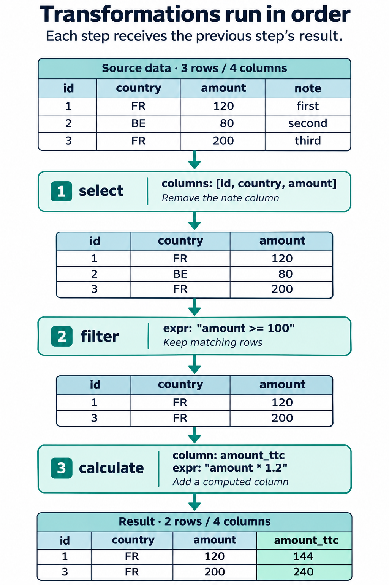
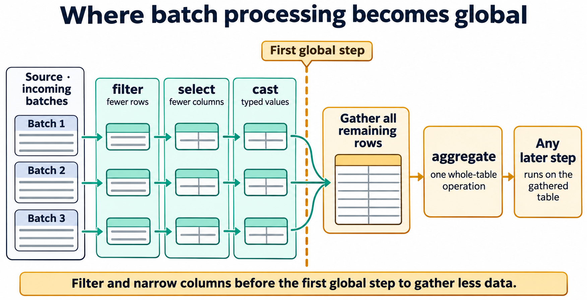
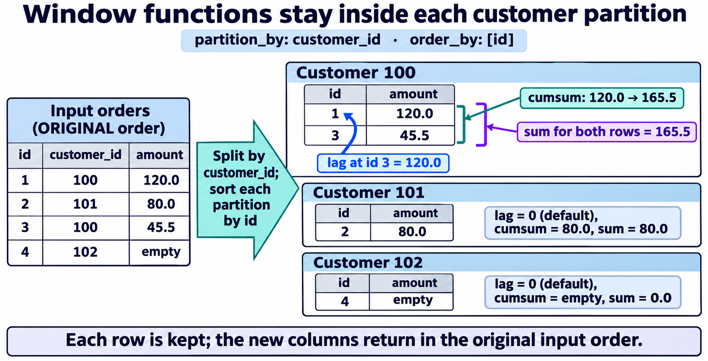
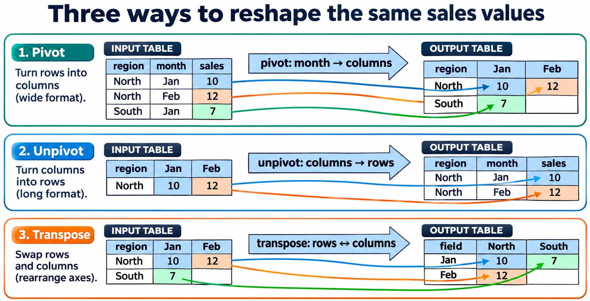
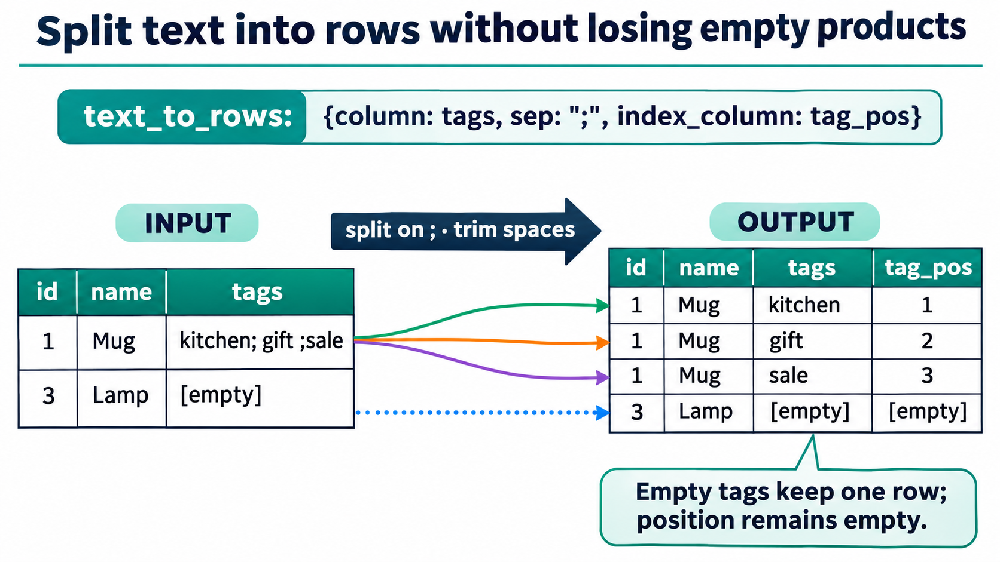
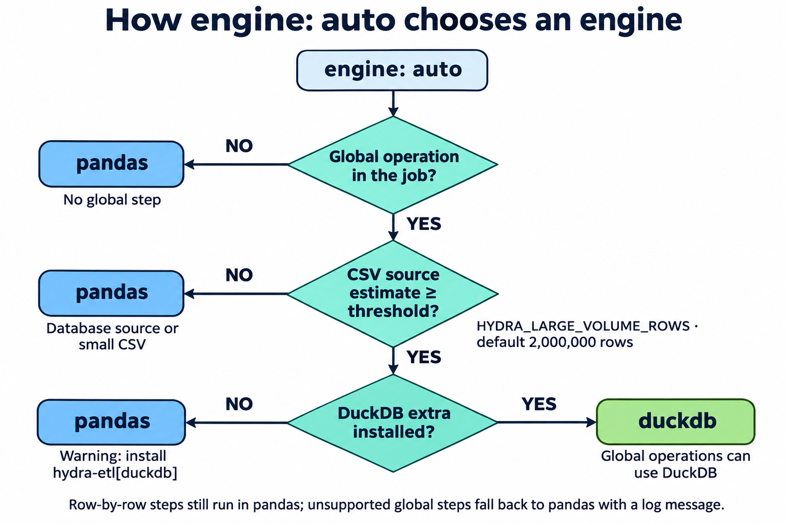
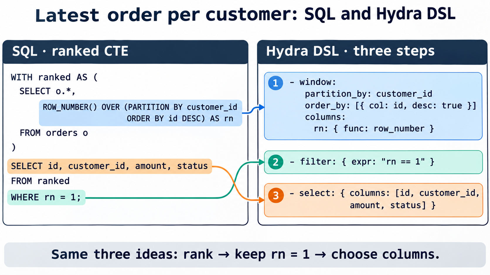

<!-- Hydra DSL White Paper — Chapter 2 (part 2): Jobs — Transformations, Engines, Expressions
     DSL format version: 1.0 · Hydra 0.19.1
     Sources: internal/parser/transform.py, internal/engines/{pandas_engine,large_volume,expr_engine,window}.py,
     internal/runner/executor.py, hydra_etl/_backend.py, CHANGELOG.md (0.17.0: join cross, text_to_rows, window;
     0.19.1: aggregate on text columns) -->

# Hydra DSL - Transformations

`transformations.yaml` lists the operations applied to the data between the source and the destination, **in order**.

## Syntax

```yaml
version: "1.0"
transformations:
  engine: auto            # optional: auto | pandas | duckdb
  steps:
    - <operation>:
        <parameters>
    - <operation>:
        <parameters>
```



## Rules for transformations

- `steps` is a list with **at least one** step.
- Each step has **exactly one key**: the name of the operation.
- The parameters of an operation are always a mapping, even when there is only one.
- Steps run from top to bottom. Each step receives the result of the previous one.
- An unknown operation is refused before the job starts.
- A column that does not exist is reported with the list of available columns.

## The 20 operations

| Family      | Operations                                                         |
| ----------- | ------------------------------------------------------------------ |
| Columns     | `select` · `rename` · `cast`                                       |
| Rows        | `filter` · `sort` · `deduplicate` · `fill_null` · `trim` · `clean` |
| Calculation | `calculate` · `script`                                             |
| Aggregation | `aggregate`                                                        |
| Analytics   | `window`                                                           |
| Combining   | `join` · `merge` · `union`                                         |
| Reshaping   | `pivot` · `unpivot` · `transpose` · `text_to_rows`                 |

No other operation exists. `window`, `text_to_rows` and `join` with `how: cross` were added in Hydra 0.17.0.

All the examples of this chapter start from this table, `orders`:

| id  | customer_id | country | amount | status    |
| --- | ----------- | ------- | ------ | --------- |
| 1   | 100         | FR      | 120.0  | paid      |
| 2   | 101         | BE      | 80.0   | cancelled |
| 3   | 100         | FR      | 45.5   | paid      |
| 4   | 102         | DE      |        | paid      |

> **[GITHUB gh-02-04 · example]** **transformations_playground** — One job folder per operation of this chapter, all reading the same `orders.csv`, each with its expected output, to run and compare.

## Three ways to look at an operation

Each operation can be read from three angles. Knowing all three avoids most surprises.

| Angle           | Question                                  | Possible answers                                                          |
| --------------- | ----------------------------------------- | ------------------------------------------------------------------------- |
| **Shape**       | What does it change in the table?         | Columns only · rows only · both · the whole layout                        |
| **Scope**       | Does it need to see all the rows at once? | **Row by row** (runs batch by batch) · **Global** (needs the whole table) |
| **Cardinality** | How many rows come out for one row in?    | 1 → 1 · 1 → 0 or 1 · 1 → n · n → 1 · n × m                                |

| Operation      | Shape                    | Scope                                                                  | Cardinality                  |
| -------------- | ------------------------ | ---------------------------------------------------------------------- | ---------------------------- |
| `select`       | Columns                  | Row by row                                                             | 1 → 1                        |
| `rename`       | Columns                  | Row by row                                                             | 1 → 1                        |
| `cast`         | Column types             | Row by row                                                             | 1 → 1                        |
| `filter`       | Rows                     | Row by row                                                             | 1 → 0 or 1                   |
| `sort`         | Row order                | **Global**                                                             | 1 → 1                        |
| `deduplicate`  | Rows                     | **Global**                                                             | n → 1                        |
| `fill_null`    | Values                   | Row by row                                                             | 1 → 1                        |
| `trim`         | Values                   | Row by row                                                             | 1 → 1                        |
| `clean`        | Values                   | Row by row                                                             | 1 → 1                        |
| `calculate`    | Adds / replaces a column | Row by row                                                             | 1 → 1                        |
| `script`       | Adds / replaces columns  | `row`: row by row · `vectorized`: **Global**                           | 1 → 1                        |
| `aggregate`    | Rows and columns         | **Global**                                                             | n → 1 per group              |
| `window`       | Adds columns             | **Global**                                                             | 1 → 1 (every row is kept)    |
| `join`         | Adds columns             | `inner` / `left` / `cross`: row by row · `right` / `outer`: **Global** | 1 → 0..n · `cross`: n × m    |
| `merge`        | Rows                     | **Global**                                                             | Replaces, adds, removes rows |
| `union`        | Rows                     | **Global**                                                             | Adds rows                    |
| `pivot`        | Layout (long → wide)     | **Global**                                                             | n → 1 per index              |
| `unpivot`      | Layout (wide → long)     | **Global**                                                             | 1 → n                        |
| `transpose`    | Layout (rows ↔ columns)  | **Global**                                                             | Rows become columns          |
| `text_to_rows` | Rows                     | Row by row                                                             | 1 → n (never 0)              |

### Why the scope matters

Hydra reads the source **in batches**. Row-by-row operations run on each batch as it arrives, so memory stays flat whatever the size of the source. From the **first global step**, Hydra gathers the rows and runs that step and **every step after it** on the whole table.

Rule of thumb: **put `filter`, `select` and `cast` before the first global step.** Fewer rows and columns are gathered, the job uses less memory and runs faster, and the result is the same.

```yaml
# Good: rows and columns are reduced batch by batch, then aggregated
steps:
  - filter:    { expr: "status == 'paid'" }
  - select:    { columns: [country, amount] }
  - cast:      { mapping: { amount: float } }
  - aggregate: { by: [country], agg: { amount: sum } }
```

```yaml
# Same result, but every row and every column is gathered before the filter
steps:
  - aggregate: { by: [country, status], agg: { amount: sum } }
  - filter:    { expr: "status == 'paid'" }
```



## Choosing the operation from the question

| You want to…                                                                        | Use                                          |
| ----------------------------------------------------------------------------------- | -------------------------------------------- |
| Keep some columns / change their names / their types                                | `select` · `rename` · `cast`                 |
| Keep some rows                                                                      | `filter`                                     |
| Remove duplicates                                                                   | `deduplicate`                                |
| Clean text (spaces, case) or replace empty values                                   | `trim` · `clean` · `fill_null`               |
| Compute a new column from the same row                                              | `calculate` (expression) · `script` (Python) |
| One row per group (totals, counts…)                                                 | `aggregate`                                  |
| Keep every row and add a rank, a running total, the previous value, the group total | `window`                                     |
| Add columns from another source                                                     | `join`                                       |
| Every combination of two lists                                                      | `join` with `how: cross`                     |
| Apply updates from another source by key                                            | `merge`                                      |
| Stack two sources                                                                   | `union`                                      |
| Values of a column become columns (and back)                                        | `pivot` · `unpivot`                          |
| Swap rows and columns                                                               | `transpose`                                  |
| A cell holds a list (`"a;b;c"`): one row per value                                  | `text_to_rows`                               |

---

# Hydra DSL - Column Operations

## select

Keeps only the listed columns, in the given order.

| Parameter | Required | Description             |
| --------- | -------- | ----------------------- |
| `columns` | Yes      | List of columns to keep |

```yaml
- select:
    columns: [id, country, amount]
```

| id  | country | amount |
| --- | ------- | ------ |
| 1   | FR      | 120.0  |
| 2   | BE      | 80.0   |
| …   | …       | …      |

- `select` also **reorders**: the output columns follow the list.
- A name listed twice is kept once.
- An unknown column stops the job with the list of available columns.

## rename

| Parameter | Required | Description          |
| --------- | -------- | -------------------- |
| `mapping` | Yes      | `old_name: new_name` |

```yaml
- rename:
    mapping:
      customer_id: client_id
      amount: total_eur
```

Columns not listed keep their name. The steps after `rename` must use the new names.

## cast

Converts the type of columns.

| Parameter | Required | Description    |
| --------- | -------- | -------------- |
| `mapping` | Yes      | `column: type` |

| Type       | Result                                                                                        |
| ---------- | --------------------------------------------------------------------------------------------- |
| `int`      | Integer. Empty values stay empty                                                              |
| `float`    | Decimal number                                                                                |
| `str`      | Text                                                                                          |
| `bool`     | True / false. Accepted: `true` `1` `yes` `oui` `on` / `false` `0` `no` `non` `off` (any case) |
| `datetime` | Date and time                                                                                 |

```yaml
- cast:
    mapping:
      id: int
      amount: float
      created_at: datetime
```

> A value that cannot be converted stops the job, with the column, the type and the reason.

**Why `cast` matters.** A CSV column is read as **text**. Comparisons, sums and window functions on numbers need a `cast` first: `"9" > "10"` is true for text, false for numbers. Since Hydra 0.19.1, `aggregate` (`sum`, `mean`) and `window` (`cumsum`, `cummin`, `cummax`, `sum`, `mean`) refuse a text column and tell you which `cast` to add.

<!-- REVIEW (décision I) : le parseur accepte `date`, mais le moteur le refuse
     (« Unsupported type »). `date` non documenté tant que ce n'est pas corrigé.
     Les alias integer/string/boolean sont refusés par le parseur. -->

---

# Hydra DSL - Row Operations

## filter

Keeps the rows for which the expression is true.

| Parameter | Required | Description                     |
| --------- | -------- | ------------------------------- |
| `expr`    | Yes      | A condition (see *Expressions*) |

### Example 1: a simple condition

```yaml
- filter:
    expr: "amount > 50"
```

| id  | customer_id | country | amount | status    |
| --- | ----------- | ------- | ------ | --------- |
| 1   | 100         | FR      | 120.0  | paid      |
| 2   | 101         | BE      | 80.0   | cancelled |

Row 4 has no amount: a comparison with an empty value is false, so the row is not kept.

### Example 2: several conditions

```yaml
- filter:
    expr: "status == 'paid' and country in ['FR', 'DE']"
```

| id  | customer_id | country | amount | status |
| --- | ----------- | ------- | ------ | ------ |
| 1   | 100         | FR      | 120.0  | paid   |
| 3   | 100         | FR      | 45.5   | paid   |
| 4   | 102         | DE      |        | paid   |

### Example 3: exclude

```yaml
- filter:
    expr: "not (status == 'cancelled')"
```

### Example 4: keep the first row of each group (with `window`)

```yaml
- window:
    partition_by: customer_id
    order_by: [{ col: amount, desc: true }]
    columns:
      rn: { func: row_number }
- filter:
    expr: "rn == 1"
```

`filter` can test any column computed before it. See *Recipes*.

## sort

| Parameter   | Default | Description                              |
| ----------- | ------- | ---------------------------------------- |
| `by`        | –       | Columns to sort by. Required             |
| `ascending` | `true`  | `true`, `false`, or one value per column |

```yaml
- sort:
    by: [amount]
    ascending: false
```

```yaml
# country A→Z, then amount from highest to lowest
- sort:
    by: [country, amount]
    ascending: [true, false]
```

- Rows with equal values keep their original order (stable sort): the result is the same at each run, and the same with DuckDB.
- Empty values go last.
- `sort` is global: place it as late as possible, after the filters.

## deduplicate

| Parameter | Default     | Description                     |
| --------- | ----------- | ------------------------------- |
| `columns` | all columns | Columns that define a duplicate |
| `keep`    | `first`     | `first` or `last` occurrence    |

```yaml
# one row per customer, the last one seen
- deduplicate:
    columns: [customer_id]
    keep: last
```

| id  | customer_id | country | amount | status    |
| --- | ----------- | ------- | ------ | --------- |
| 2   | 101         | BE      | 80.0   | cancelled |
| 3   | 100         | FR      | 45.5   | paid      |
| 4   | 102         | DE      |        | paid      |

"First" and "last" follow the order of the rows. To keep "the most recent" or "the biggest", `sort` first, or use `window` + `filter` (see *Recipes*).

## fill_null

Replaces empty values.

| Parameter | Description                                   |
| --------- | --------------------------------------------- |
| `value`   | One value for every column                    |
| `columns` | A different value per column: `column: value` |

One of the two is required.

```yaml
- fill_null:
    value: 0
```

```yaml
- fill_null:
    columns:
      amount: 0
      country: "UNKNOWN"
```

Prefer `columns`: a single `value` also fills text columns with `0`.

## trim

Removes the spaces at the start and end of text values.

| Parameter | Default          | Description     |
| --------- | ---------------- | --------------- |
| `columns` | all text columns | Columns to trim |

```yaml
- trim:
    columns: [country, status]
```

## clean

Normalises text: removes the spaces at the start and end, replaces repeated spaces with one, and optionally changes the case.

| Parameter | Default          | Description                |
| --------- | ---------------- | -------------------------- |
| `columns` | all text columns | Columns to clean           |
| `case`    | `none`           | `none` · `lower` · `upper` |

```yaml
- clean:
    columns: [status]
    case: upper
```

| Before           | After          |
| ---------------- | -------------- |
| `"  paid "`      | `"PAID"`       |
| `"can   celled"` | `"CAN CELLED"` |

Any other value of `case` is refused.

**Clean before you compare.** `clean` before `deduplicate`, `join` or `aggregate`: `"Paid "` and `"paid"` are two different keys until they are cleaned.

> **[LAB lab-02-06 · Killercoda]** **Clean a messy file** — Take a CSV with spaces, mixed case, duplicates and empty cells, and make it clean with `trim`, `clean`, `deduplicate` and `fill_null`, checking the file after each step.

---

# Hydra DSL - Calculation

## calculate

Adds a column (or replaces an existing one) computed from an expression.

| Parameter | Required | Description                    |
| --------- | -------- | ------------------------------ |
| `column`  | Yes      | Name of the column to create   |
| `expr`    | Yes      | Expression (see *Expressions*) |

### Example 1: arithmetic

```yaml
- calculate:
    column: amount_ttc
    expr: "amount * 1.2"
```

### Example 2: from several columns

```yaml
- calculate:
    column: total
    expr: "price * qty - discount"
```

### Example 3: a true/false flag

```yaml
- calculate:
    column: is_big
    expr: "amount > 100"
```

| id  | amount | is_big |
| --- | ------ | ------ |
| 1   | 120.0  | True   |
| 2   | 80.0   | False  |

### Example 4: from a column computed by `window`

```yaml
- window:
    partition_by: country
    columns:
      country_total: { func: sum, col: amount }
- calculate:
    column: share
    expr: "amount / country_total"
```

`calculate` reads only the **current row**. To use other rows (previous row, group total, rank), compute them with `window` first.

## script

Runs a short piece of Python when an expression is not enough. You declare what the code reads (`inputs`) and what it produces (`outputs`).

| Parameter | Default      | Description                                               |
| --------- | ------------ | --------------------------------------------------------- |
| `inputs`  | `[]`         | Columns given to the code                                 |
| `outputs` | –            | Columns produced, with their type. Required               |
| `code`    | –            | Python code. Required                                     |
| `mode`    | `vectorized` | `vectorized` (whole columns) or `row` (one row at a time) |

Output types: `int` · `float` · `str` · `bool` · `date` · `datetime` · `any`.

### Example 1: `row` mode

Each input is a single value. Each output must be assigned.

```yaml
- script:
    mode: row
    inputs: [amount, country]
    outputs:
      segment: str
    code: |
      if amount is None:
          segment = "unknown"
      elif country == "FR" and amount > 100:
          segment = "premium_fr"
      else:
          segment = "standard"
```

### Example 2: `vectorized` mode

Each input is a whole column. Faster on large data.

```yaml
- script:
    inputs: [price, qty]
    outputs:
      total: float
    code: |
      total = price * qty
```

### Example 3: using a parameter

Job parameters are available, read-only, in `params`:

```yaml
- script:
    mode: row
    inputs: [amount]
    outputs:
      above_threshold: bool
    code: |
      above_threshold = amount > params["min_amount"]
```

## Rules for scripts

- No `import`, no file or network access.
- Only these built-in functions are available: `abs round min max sum len int float str bool list dict tuple set sorted reversed zip range enumerate map filter any all divmod pow isinstance print format repr ord chr hex bin`.
- Every column listed in `outputs` must be assigned by the code.
- `print(...)` output appears in the job log.
- `vectorized` mode is **global** (the code may compute a mean or a rank over the whole column, so it receives every row at once). `row` mode runs batch by batch.

## Which one: `calculate`, `script` or `window`?

| Need                                                        | Operation                     |
| ----------------------------------------------------------- | ----------------------------- |
| Arithmetic, comparison, logic on the current row            | `calculate`                   |
| `if / elif / else`, loops, text handling on the current row | `script` in `row` mode        |
| Rank, previous / next value, running total, group total     | `window`                      |
| Anything else on whole columns                              | `script` in `vectorized` mode |

Prefer the first operation that fits: it is shorter, checked before the run, and faster.

> **[LAB lab-02-07 · Killercoda]** **From expression to script** — Compute a customer segment first with `calculate`, then with `script` in `row` mode, then in `vectorized` mode, and compare.

---

# Hydra DSL - Aggregation

## aggregate

Groups the rows and computes one value per group.

| Parameter | Required | Description                            |
| --------- | -------- | -------------------------------------- |
| `by`      | Yes      | Grouping columns                       |
| `agg`     | Yes      | Output columns and how to compute them |

Functions: `sum` · `count` · `mean` · `avg` (same as `mean`) · `min` · `max` · `first` · `last`.

`sum` and `mean` need a numeric column. A column read from a CSV is text until it is cast: add a `cast` step before `aggregate`, otherwise the step fails with `sum needs a numeric column ('amount' is object)` (Hydra 0.19.1+; before, the values were silently concatenated).

### Example 1: long form

```yaml
- aggregate:
    by: [country]
    agg:
      total_amount: { func: sum, col: amount }
      nb_orders:    { func: count, col: id }
```

| country | total_amount | nb_orders |
| ------- | ------------ | --------- |
| BE      | 80.0         | 1         |
| DE      | 0.0          | 1         |
| FR      | 165.5        | 2         |

Empty values are ignored: the sum of a group with no value is `0` (DE). `count` counts the non-empty values of `col`.

### Example 2: short form

When the output column has the same name as the source column:

```yaml
- aggregate:
    by: [country]
    agg:
      amount: sum
```

### Example 3: several grouping columns

```yaml
- aggregate:
    by: [country, status]
    agg:
      avg_amount: { func: avg, col: amount }
      max_amount: { func: max, col: amount }
```

### `aggregate` or `window`?

Both use groups. `aggregate` **replaces** the rows with one row per group; `window` **keeps** every row and adds the group value on each one.

| `aggregate` by `country`, `sum(amount)` | `window` partition by `country`, `sum(amount)` |
| --------------------------------------- | ---------------------------------------------- |
| 3 rows: BE 80 · DE 0 · FR 165.5         | 4 rows, each with its country total            |

> **[FIGURE fig-02-08 · diagram]** Rows coloured by `country`, gathered into three groups, each group reduced to one row with `sum(amount)` and `count(id)`.

<!-- REVIEW (décision B) : le code transmet `func` à pandas sans contrôle (median,
     std, nunique… fonctionnent). Seules les 8 fonctions annoncées sont documentées. -->

---

# Hydra DSL - Window Functions

## window

Adds columns computed **over a group of rows**, and **keeps every row**, in its input order. It answers the questions that need other rows than the current one: *What is the rank of this order for its customer? What was the previous amount? What is the running total? What share of the country total is this order?*

| Parameter      | Default     | Description                                                                       |
| -------------- | ----------- | --------------------------------------------------------------------------------- |
| `partition_by` | whole table | Column or list of columns splitting the rows into independent groups (partitions) |
| `order_by`     | –           | Order inside each partition: column names, or `{col, desc}` items                 |
| `columns`      | –           | Required. `output_column: {func, col, offset, default}`                           |

### Functions

| Family          | Functions                                                   | Needs `order_by` | Options                                                |
| --------------- | ----------------------------------------------------------- | ---------------- | ------------------------------------------------------ |
| Rank            | `row_number` · `rank` · `dense_rank`                        | Yes              | none                                                   |
| Offset          | `lag` (previous row) · `lead` (next row)                    | Yes              | `col` (required), `offset` (≥ 1, default 1), `default` |
| Running         | `cumsum` · `cumcount` · `cummin` · `cummax`                 | Yes              | `col` (optional for `cumcount`)                        |
| Whole partition | `sum` · `mean` · `min` · `max` · `count` · `first` · `last` | No               | `col` (required)                                       |

### Example 1: per customer, numbered, with the previous amount and the running total

```yaml
- window:
    partition_by: customer_id
    order_by: [id]
    columns:
      order_no:       { func: row_number }
      prev_amount:    { func: lag, col: amount, default: 0 }
      running_total:  { func: cumsum, col: amount }
      customer_total: { func: sum, col: amount }
```

| id  | customer_id | amount | order_no | prev_amount | running_total | customer_total |
| --- | ----------- | ------ | -------- | ----------- | ------------- | -------------- |
| 1   | 100         | 120.0  | 1        | 0.0         | 120.0         | 165.5          |
| 2   | 101         | 80.0   | 1        | 0.0         | 80.0          | 80.0           |
| 3   | 100         | 45.5   | 2        | 120.0       | 165.5         | 165.5          |
| 4   | 102         |        | 1        | 0.0         |               | 0.0            |

- The rows stay in their input order: only columns are added.
- `prev_amount`: the first order of each customer has no previous row, so it gets `default` (`0`).
- `running_total` of order 4 is empty: no value has been seen yet in its partition.
- `customer_total` of customer 102 is `0`: the sum of a partition with no value is `0`, as in `aggregate`.

### Example 2: `row_number`, `rank`, `dense_rank`

On a `scores` table, ordered by `score` descending:

```yaml
- window:
    order_by: [{ col: score, desc: true }]
    columns:
      row_number: { func: row_number }
      rank:       { func: rank }
      dense_rank: { func: dense_rank }
```

| player | score | row_number | rank | dense_rank |
| ------ | ----- | ---------- | ---- | ---------- |
| Ana    | 90    | 1          | 1    | 1          |
| Ben    | 85    | 2          | 2    | 2          |
| Chloé  | 85    | 3          | 2    | 2          |
| Dan    | 70    | 4          | 4    | 3          |

- `row_number`: always 1, 2, 3… Ties are broken by input order (Ben before Chloé), so the result is the same at each run.
- `rank`: equal rows share a rank, and the next rank skips (4).
- `dense_rank`: equal rows share a rank, no gap (3).

### Example 3: share of the country total (no `order_by`)

```yaml
- window:
    partition_by: country
    columns:
      country_total: { func: sum, col: amount }
- calculate:
    column: share
    expr: "amount / country_total"
```

| id  | country | amount | country_total | share |
| --- | ------- | ------ | ------------- | ----- |
| 1   | FR      | 120.0  | 165.5         | 0.725 |
| 2   | BE      | 80.0   | 80.0          | 1.0   |
| 3   | FR      | 45.5   | 165.5         | 0.275 |
| 4   | DE      |        | 0.0           |       |

### Example 4: the two previous values, with a text default

```yaml
- window:
    partition_by: customer_id
    order_by: [id]
    columns:
      prev_status:   { func: lag, col: status, default: "none" }
      prev2_amount:  { func: lag, col: amount, offset: 2 }
      next_amount:   { func: lead, col: amount }
```

## Rules for window

- Every row is kept, in its input order. `window` adds columns; it never removes or moves a row.
- `order_by` sorts inside each partition. **Empty values go last**, even with `desc: true`. Equal rows keep their input order.
- Rank, offset and running functions **require** `order_by`. Whole-partition functions do not (`first` / `last` use it when given, the input order otherwise).
- Without `partition_by`, the whole table is one partition.
- `lag` / `lead`: `default` applies **only** when the offset leaves the partition. An empty value inside the partition stays empty.
- Running functions skip empty values: the row keeps the running value reached so far (empty while no value has been seen).
- Whole-partition functions ignore empty values, as `aggregate`. `first` / `last` return the first / last non-empty value.
- `cumsum`, `cummin`, `cummax`, `sum` and `mean` need a numeric column: `cast` it first.
- An output column that already exists is refused: choose another name.
- An option that does not apply to the function (for example `offset` on `sum`) is refused, never ignored.
- `window` is global. With the large-volume engine it runs in DuckDB (`OVER (PARTITION BY … ORDER BY …)`) with the same rows, values and types as pandas.



> **[LAB lab-02-11 · Killercoda]** **Window functions** — On a sales file, number the orders of each customer, keep the latest one, compute the running total per month and the share of each order in its country total.

---

# Hydra DSL - Combining Data

`join`, `merge` and `union` combine the main flow with a **second source**, declared in `sources.yaml` and referenced by its id in `right`.

```yaml
# sources.yaml
sources:
  orders:            # main flow (pipeline.from)
    type: csv
    connection: {}
    extract: { table: data/orders.csv }
  customers:         # second source, used by right:
    type: csv
    connection: {}
    extract: { table: data/customers.csv }
```

The second source can be of **any type**: a CSV file can be joined with a MySQL table, a PostgreSQL table merged into a Parquet file.

`customers`:

| customer_id | name  |
| ----------- | ----- |
| 100         | Alice |
| 101         | Bob   |
| 103         | Chloé |

<!-- REVIEW (décision D) : `right` accepte aussi une source inline (dict avec `type`).
     Non documenté tant que ce n'est pas décidé. -->

## join

| Parameter               | Default    | Description                                        |
| ----------------------- | ---------- | -------------------------------------------------- |
| `right`                 | –          | Id of the second source. Required                  |
| `key`                   | –          | Common column, or list of columns                  |
| `left_key`, `right_key` | –          | When the key has a different name on each side     |
| `how`                   | `inner`    | `inner` · `left` · `right` · `outer` · `cross`     |
| `max_rows`              | `10000000` | `how: cross` only. Maximum number of rows produced |

`key`, or `left_key` + `right_key`, is required — except with `how: cross`, which takes no key.

> **[FIGURE fig-02-09 · diagram]** The four `how` values as Venn diagrams on `orders` and `customers`, with the resulting rows listed under each.

### Example 1: inner join

```yaml
- join:
    right: customers
    key: customer_id
```

| id  | customer_id | country | amount | status    | name  |
| --- | ----------- | ------- | ------ | --------- | ----- |
| 1   | 100         | FR      | 120.0  | paid      | Alice |
| 2   | 101         | BE      | 80.0   | cancelled | Bob   |
| 3   | 100         | FR      | 45.5   | paid      | Alice |

Order 4 (customer 102) has no match and is dropped.

### Example 2: left join

```yaml
- join:
    right: customers
    key: customer_id
    how: left
```

All the orders are kept; `name` is empty for customer 102.

### Example 3: keys with different names

```yaml
- join:
    right: customers
    left_key: client_id
    right_key: customer_id
```

### Example 4: composite key

```yaml
- join:
    right: prices
    key: [country, product_id]
```

### Example 5: cross join — every combination

`how: cross` pairs **every row** of the main flow with **every row** of `right`, in order. No key.

`sizes`:

| size |
| ---- |
| S    |
| M    |
| L    |

`colors` (second source):

| color |
| ----- |
| red   |
| blue  |

```yaml
- join:
    right: colors
    how: cross
```

| size | color |
| ---- | ----- |
| S    | red   |
| S    | blue  |
| M    | red   |
| M    | blue  |
| L    | red   |
| L    | blue  |

Typical uses: build a product catalogue (size × color), a calendar grid (stores × days) to find the days without sales, a test matrix.

**Guard.** A cross join grows fast (10 000 × 10 000 = 100 million rows). The job stops **before** producing the batch that would exceed `max_rows` (counted over all batches), with the number of rows it would have produced. Filter the inputs first, or raise `max_rows` if this size is intended:

```yaml
- join:
    right: calendar
    how: cross
    max_rows: 50000000
```

## Rules for join

- When both sides have a column with the same name (other than the key), the column from `right` gets the suffix `_r`.
- `key`, `left_key` or `right_key` with `how: cross` is refused. `max_rows` without `how: cross` is refused.
- A key that appears several times on the right multiplies the rows: one order joined to a customer listed twice gives two rows. `deduplicate` the right source by its key if it is meant to be unique.
- `inner`, `left` and `cross` run batch by batch. `right` and `outer` are global (the right rows without a match must be added once, not once per batch).

## merge

Applies the rows of the second source **onto** the main flow, by key: rows with a known key are replaced, new keys are added.

| Parameter          | Default | Description                                            |
| ------------------ | ------- | ------------------------------------------------------ |
| `right`            | –       | Id of the second source. Required                      |
| `key`              | –       | Matching column or columns. Required                   |
| `delete_unmatched` | `false` | Also remove rows whose key is not in the second source |

```yaml
- merge:
    right: customer_updates
    key: customer_id
```

| Main flow | Second source    | Result           |
| --------- | ---------------- | ---------------- |
| 100 Alice | 100 Alice Martin | 100 Alice Martin |
| 101 Bob   | –                | 101 Bob          |
| –         | 104 David        | 104 David        |

With `delete_unmatched: true`, row 101 is removed: the flow is fully synchronised with the second source.

`merge` works on the **data in the flow**. To update rows in the destination table, use the load mode `upsert` (see *Jobs, part 1*).

## union

Stacks the rows of the second source under the main flow. Columns are matched by name; a missing column is left empty.

| Parameter  | Default | Description                       |
| ---------- | ------- | --------------------------------- |
| `right`    | –       | Id of the second source. Required |
| `distinct` | `false` | `true` removes identical rows     |

```yaml
- union:
    right: orders_2025
    distinct: true
```

`distinct: false` is `UNION ALL` in SQL; `distinct: true` is `UNION`.

## join, merge or union?

| The second source brings…            | Operation                |
| ------------------------------------ | ------------------------ |
| New **columns** for existing rows    | `join`                   |
| New **versions** of rows, by key     | `merge`                  |
| More **rows** of the same kind       | `union`                  |
| A list to **combine** with every row | `join` with `how: cross` |

> **[LAB lab-02-08 · Killercoda]** **Join, merge, union** — Combine an orders file with a customers file in the three ways, and explain each result row.

---

# Hydra DSL - Reshaping Data

## pivot

Turns the values of one column into columns.

| Parameter | Default | Description                                                                                     |
| --------- | ------- | ----------------------------------------------------------------------------------------------- |
| `index`   | –       | Columns kept as rows. Required                                                                  |
| `column`  | –       | Column whose values become columns. Required                                                    |
| `values`  | –       | Column that fills the cells. Required                                                           |
| `aggfunc` | `first` | How to combine several values for the same cell (`sum`, `mean`, `min`, `max`, `count`, `first`) |

```yaml
- pivot:
    index: [region]
    column: month
    values: sales
    aggfunc: sum
```

| region | month | sales |
| ------ | ----- | ----- |
| North  | Jan   | 10    |
| North  | Feb   | 12    |
| South  | Jan   | 7     |

becomes

| region | Feb | Jan |
| ------ | --- | --- |
| North  | 12  | 10  |
| South  |     | 7   |

The new columns are **found in the data**: you do not list `Jan`, `Feb`… A month that appears next time becomes a new column. If the destination expects fixed columns, add a `select` after `pivot`.

## unpivot

The opposite of `pivot`: turns columns into rows.

| Parameter    | Default           | Description                                       |
| ------------ | ----------------- | ------------------------------------------------- |
| `id_vars`    | –                 | Columns kept as they are. Required                |
| `value_vars` | all other columns | Columns turned into rows                          |
| `var_name`   | `variable`        | Name of the column receiving the old column names |
| `value_name` | `value`           | Name of the column receiving the values           |

```yaml
- unpivot:
    id_vars: [region]
    value_vars: [Jan, Feb]
    var_name: month
    value_name: sales
```

| region | Jan | Feb |
| ------ | --- | --- |
| North  | 10  | 12  |

becomes

| region | month | sales |
| ------ | ----- | ----- |
| North  | Jan   | 10    |
| North  | Feb   | 12    |

## transpose

Swaps rows and columns.

| Parameter     | Default  | Description                                       |
| ------------- | -------- | ------------------------------------------------- |
| `index_col`   | –        | Column whose values become the new column names   |
| `header_name` | `column` | Name of the column receiving the old column names |

```yaml
- transpose:
    index_col: metric
    header_name: field
```

| metric  | 2024 | 2025 |
| ------- | ---- | ---- |
| revenue | 100  | 130  |
| cost    | 60   | 70   |

becomes

| field | revenue | cost |
| ----- | ------- | ---- |
| 2024  | 100     | 60   |
| 2025  | 130     | 70   |

## text_to_rows

Splits a text column into **one row per value**: `"a;b;c"` gives three rows, the other columns are copied on each.

| Parameter      | Default | Description                                                    |
| -------------- | ------- | -------------------------------------------------------------- |
| `column`       | –       | Column to split. Required                                      |
| `sep`          | `,`     | Separator, plain text                                          |
| `regex`        | `false` | `true`: `sep` is a regular expression                          |
| `trim`         | `true`  | Remove the spaces around each value                            |
| `keep_empty`   | `false` | Keep the empty values (`"a;;b"` → `a`, `""`, `b`)              |
| `index_column` | –       | Optional: new column with the position of the value (1, 2, 3…) |

`products`:

| id  | name | tags                  |
| --- | ---- | --------------------- |
| 1   | Mug  | `kitchen; gift ;sale` |
| 2   | Pen  | `office`              |
| 3   | Lamp |                       |
| 4   | Box  | `gift;;`              |

### Example 1: one row per tag, with its position

```yaml
- text_to_rows:
    column: tags
    sep: ";"
    index_column: tag_pos
```

| id  | name | tags    | tag_pos |
| --- | ---- | ------- | ------- |
| 1   | Mug  | kitchen | 1       |
| 1   | Mug  | gift    | 2       |
| 1   | Mug  | sale    | 3       |
| 2   | Pen  | office  | 1       |
| 3   | Lamp |         |         |
| 4   | Box  | gift    | 1       |

- Spaces around each value are removed (`" gift "` → `gift`).
- Empty values are dropped (`"gift;;"` → one row).
- Product 3 has no tag: it **keeps one row**, with an empty tag. A row is never lost.
- `index_column` is placed right after `column`.

### Example 2: several separators

```yaml
- text_to_rows:
    column: emails
    sep: "[;,|]"
    regex: true
```

`"a@x.com, b@x.com|c@x.com"` gives three rows.

### Example 3: count the products per tag

```yaml
- text_to_rows:
    column: tags
    sep: ";"
- aggregate:
    by: [tags]
    agg:
      nb_products: { func: count, col: id }
```

## Rules for text_to_rows

- A row with an empty value, or with no non-empty part, gives **one row** with an empty value (and an empty position). No input row is lost.
- `sep` cannot be empty. With `regex: true`, an invalid expression is refused before the run.
- `index_column` must be a new column name, different from `column`.
- Unknown options are refused.
- `text_to_rows` runs batch by batch: it can split a file of any size.





---

# Hydra DSL - Recipes

Common questions, answered by combining operations.

## Latest order of each customer

```yaml
- window:
    partition_by: customer_id
    order_by: [{ col: id, desc: true }]
    columns:
      rn: { func: row_number }
- filter:
    expr: "rn == 1"
- select:
    columns: [id, customer_id, amount, status]
```

Change `rn == 1` to `rn <= 3` for the top 3 per customer.

## Change compared with the previous period

```yaml
- cast:
    mapping: { revenue: float }
- window:
    partition_by: store
    order_by: [month]
    columns:
      prev_revenue: { func: lag, col: revenue }
- calculate:
    column: growth_pct
    expr: "(revenue - prev_revenue) / prev_revenue * 100"
```

## Running total and cumulative share

```yaml
- window:
    partition_by: country
    order_by: [id]
    columns:
      running:       { func: cumsum, col: amount }
      country_total: { func: sum,    col: amount }
- calculate:
    column: cumulative_pct
    expr: "running / country_total * 100"
```

## Days without sales

```yaml
# stores × calendar, then the sales of each day
- join:
    right: calendar
    how: cross
- join:
    right: daily_sales
    key: [store_id, day]
    how: left
- filter:
    expr: "amount != amount"      # empty amount: no sale that day
```

<!-- REVIEW : `amount != amount` est l'idiome pandas pour « valeur vide ». Pas de
     fonction isnull() documentée dans les expressions. À confirmer ou à remplacer
     par une opération dédiée. -->

## Clean, deduplicate, enrich, aggregate

```yaml
- clean:     { columns: [email], case: lower }
- deduplicate:
    columns: [email]
- join:
    right: crm_accounts
    key: email
    how: left
- fill_null:
    columns: { segment: "unknown" }
- aggregate:
    by: [segment]
    agg:
      nb_contacts: { func: count, col: email }
```

> **[GITHUB gh-02-06 · example]** **transformation_recipes** — One job per recipe of this page, each with its input files and expected output.

---

# Hydra DSL - Transformation Engines

The **engine** is what executes the steps. Hydra has two:

| Engine   | Strength                                                                                                                     | Install                           |
| -------- | ---------------------------------------------------------------------------------------------------------------------------- | --------------------------------- |
| `pandas` | Reference engine, every operation                                                                                            | built in                          |
| `duckdb` | Large volumes: `aggregate`, `sort`, `window`, and `join` with `how: right` or `outer`, computed on disk instead of in memory | `pip install "hydra-etl[duckdb]"` |

Both give the **same result**. Only the speed and the memory used change.

## Choosing the engine

```yaml
version: "1.0"
transformations:
  engine: auto
  steps:
    - aggregate:
        by: [country]
        agg:
          amount: sum
```

| `engine`         | What happens                                                                                                            |
| ---------------- | ----------------------------------------------------------------------------------------------------------------------- |
| `auto` (default) | `pandas`, unless the job has a global operation **and** the CSV source is estimated above 2 000 000 rows: then `duckdb` |
| `pandas`         | Always pandas                                                                                                           |
| `duckdb`         | DuckDB for the global operations it can translate, pandas for the others                                                |



## Rules for engines

- `engine` is optional. Without it, `auto` is used.
- The variable `HYDRA_ENGINE` **overrides** `engine:` for every job: `HYDRA_ENGINE=pandas hdrctl run .`
- The threshold of `auto` is set by `HYDRA_LARGE_VOLUME_ROWS` (default `2000000`).
- `auto` estimates the size of **CSV** sources only. For a database source, write `engine: duckdb` to use DuckDB.
- `engine: duckdb` without the DuckDB extra stops the job with the install command. `auto` falls back to pandas with a warning.
- Row-by-row operations always run in pandas, batch by batch.
- DuckDB runs `aggregate`, `sort`, `window` and `join` (`right` / `outer`). If it cannot guarantee the same result as pandas for a step (a column type, an option), the step is handed back to pandas, with a message in the log — never silently.

## Example 1: let Hydra decide

```yaml
transformations:
  steps:
    - filter:
        expr: "status == 'paid'"
    - aggregate:
        by: [country]
        agg:
          amount: sum
```

The job log tells which engine was chosen, and why:

```
Job 'sales': engine pandas (auto : ≈ 120 000 lignes estimées (< 2 000 000))
```

## Example 2: force DuckDB on a database source

```yaml
transformations:
  engine: duckdb
  steps:
    - sort:
        by: [created_at]
```

## Example 3: force pandas for one run

```bash
HYDRA_ENGINE=pandas hdrctl run jobs/sales
```

## Under the hood: two automatic accelerations

These need no DSL key. They are listed so that you recognise them in the logs.

| Acceleration                        | Applies to                                        | Controlled by                                                                                   |
| ----------------------------------- | ------------------------------------------------- | ----------------------------------------------------------------------------------------------- |
| **numexpr**                         | Large `filter` and `calculate` on numeric columns | `HYDRA_NUMEXPR` (`1` default: only where the result is bit-for-bit identical · `all` · `0` off) |
| **Native CSV reader/writer (Rust)** | Reading and writing CSV                           | `pip install "hydra-etl[native]"`, then `HYDRA_BACKEND=rust` or a `hydra.backends.yaml` file    |

> **[LAB lab-02-09 · Killercoda]** **pandas vs DuckDB** — Run the same aggregation on a 5-million-row CSV with `engine: pandas`, then `engine: auto`, and compare time and memory in the job report.

> **[GITHUB gh-02-05 · example]** **large_volume_engine** — Job with a data generator script for a large CSV, and three variants of `transformations.yaml` (`auto`, `pandas`, `duckdb`).

<!-- REVIEW : la ligne de log de l'exemple 1 est en français dans le code
     (executor.py, large_volume.decide). À traduire côté code (Règle −2) ou à
     retirer de la page. -->

---

# Hydra DSL - Expressions

`filter.expr` and `calculate.expr` use the same small expression language. Column names are written as they are.

## Rules for expressions

- Write the whole expression between quotes in YAML: `expr: "amount > 50"`.
- Text values go between single quotes inside: `"status == 'paid'"`.
- A column name with spaces goes between backticks: ``"`unit price` > 10"``.
- `filter` needs a condition (true/false). `calculate` accepts any value.
- An expression reads the **current row** only. For other rows, use `window` first.
- A comparison with an empty value is false.

## Operators

| Kind       | Operators                     | Example                     |
| ---------- | ----------------------------- | --------------------------- |
| Arithmetic | `+` `-` `*` `/` `//` `%` `**` | `"price * qty"`             |
| Comparison | `==` `!=` `<` `<=` `>` `>=`   | `"amount >= 100"`           |
| Logic      | `and` `or` `not`              | `"paid and not refunded"`   |
| Membership | `in` `not in`                 | `"country in ['FR', 'BE']"` |
| Grouping   | `( )`                         | `"(a + b) * 2"`             |

## Examples, from simple to complex

```yaml
- filter:
    expr: "amount > 0"
```

```yaml
- filter:
    expr: "country == 'FR' or (country == 'BE' and amount > 100)"
```

```yaml
- filter:
    expr: "status not in ['cancelled', 'refunded']"
```

```yaml
- calculate:
    column: margin_pct
    expr: "(price - cost) / price * 100"
```

```yaml
- calculate:
    column: unit_price
    expr: "`total amount` / qty"
```

## When the expression is wrong

```yaml
- filter:
    expr: "amount >> 50"
```

The job stops on this step and shows the expression and the reason. `hdrctl validate` checks the syntax of every expression before the run.

> **[LAB lab-02-10 · Killercoda]** **Expression drills** — Ten small filtering and calculation exercises on the `orders` table, each checked automatically.

## Where expressions are used

| Place                           | Language                              |
| ------------------------------- | ------------------------------------- |
| `filter.expr`, `calculate.expr` | This page                             |
| `script.code`                   | Restricted Python (see *Calculation*) |
| `when:` of a workflow step      | See *Workflows*                       |

---

# Hydra DSL vs SQL

SQL is the language every data person knows. Hydra does not replace it: a database source can still push work to the database with `extract.query`. But for the transformation layer of a pipeline, the Hydra DSL is easier to read, to review and to move from one system to another. The same five questions, written both ways.

## 1. Paid revenue per country

**SQL**

```sql
SELECT country,
       SUM(CAST(amount AS DECIMAL(12,2))) AS total_amount,
       COUNT(id)                          AS nb_orders
FROM orders
WHERE status = 'paid'
GROUP BY country;
```

**Hydra**

```yaml
- filter:    { expr: "status == 'paid'" }
- cast:      { mapping: { amount: float } }
- aggregate:
    by: [country]
    agg:
      total_amount: { func: sum,   col: amount }
      nb_orders:    { func: count, col: id }
```

SQL is **written** `SELECT → FROM → WHERE → GROUP BY` but **executed** `FROM → WHERE → GROUP BY → SELECT`. Hydra is written in the order it runs: read it from top to bottom and you know what happens to the data.

## 2. Latest order of each customer

**SQL**

```sql
WITH ranked AS (
  SELECT o.*,
         ROW_NUMBER() OVER (PARTITION BY customer_id
                            ORDER BY id DESC) AS rn
  FROM orders o
)
SELECT id, customer_id, amount, status
FROM ranked
WHERE rn = 1;
```

**Hydra**

```yaml
- window:
    partition_by: customer_id
    order_by: [{ col: id, desc: true }]
    columns:
      rn: { func: row_number }
- filter: { expr: "rn == 1" }
- select: { columns: [id, customer_id, amount, status] }
```

No sub-query, no alias to carry, no nesting: three steps, one per idea. And the result is defined the same way everywhere — in SQL, `ORDER BY amount DESC` puts empty values **first** in PostgreSQL and **last** in MySQL and SQL Server; in Hydra, empty values are always last, and ties always keep the input order.

## 3. One row per tag

**SQL** — one version per database:

```sql
-- PostgreSQL
SELECT p.id, p.name, trim(t.tag) AS tag
FROM products p
CROSS JOIN LATERAL unnest(string_to_array(p.tags, ';')) AS t(tag);

-- SQL Server
SELECT p.id, p.name, TRIM(s.value) AS tag
FROM products p
CROSS APPLY STRING_SPLIT(p.tags, ';') AS s;

-- MySQL 8: a recursive CTE or JSON_TABLE, about fifteen lines
```

**Hydra** — one version, for every source (CSV, Parquet, MySQL, PostgreSQL, SQL Server, MongoDB…):

```yaml
- text_to_rows:
    column: tags
    sep: ";"
    index_column: tag_pos
```

The SQL versions also lose product 3 (no tag) unless you switch to an outer apply / left join; Hydra keeps it by default.

## 4. Months as columns

**SQL** — the values must be known when the query is written:

```sql
SELECT region,
       SUM(CASE WHEN month = 'Jan' THEN sales END) AS "Jan",
       SUM(CASE WHEN month = 'Feb' THEN sales END) AS "Feb"
       -- one line per month, to update every month
FROM sales
GROUP BY region;
```

**Hydra** — the columns come from the data:

```yaml
- pivot:
    index: [region]
    column: month
    values: sales
    aggfunc: sum
```

## 5. Apply updates by key

**SQL** — `MERGE` in SQL Server and PostgreSQL 15+, `INSERT … ON DUPLICATE KEY UPDATE` in MySQL, `INSERT … ON CONFLICT` in PostgreSQL and SQLite, each with its own syntax. And both tables must be in the same database.

**Hydra**

```yaml
- merge:
    right: customer_updates
    key: customer_id
```

`customer_updates` can be a CSV file and the main flow a database table.

## Side by side

| Criterion             | SQL                                                 | Hydra DSL                                                              |
| --------------------- | --------------------------------------------------- | ---------------------------------------------------------------------- |
| Reading order         | Different from the execution order                  | Top to bottom = execution order                                        |
| One idea per…         | Clause, often nested (sub-queries, CTEs)            | Step                                                                   |
| Dialects              | One per database (split, pivot, upsert, null order) | One language, every source                                             |
| Several sources       | Same database only                                  | Any source with any source (CSV × MySQL × Parquet…)                    |
| Text cleaning         | Nested functions (`UPPER(TRIM(REGEXP_REPLACE(…)))`) | `clean: { case: upper }`                                               |
| Checks before the run | At execution, by the database                       | `hdrctl validate`: unknown operation, wrong option, invalid expression |
| Errors                | Database message                                    | Step number, column, list of available columns, fix to apply           |
| Review in Git         | A changed query is often a rewritten block          | A changed step is a changed line                                       |
| Determinism           | Ties and empty values depend on the database        | Stable order, empty values last, same result in pandas and DuckDB      |
| Visual editing        | –                                                   | Each step is a node in Hydra Studio, and back to YAML without loss     |

**When SQL stays the right tool:** filtering or joining large tables **inside** one database before the extraction. Write it in the source's `extract.query` and let Hydra do the rest.



---

# Hydra DSL vs Python

Python with pandas can do everything Hydra does — Hydra itself runs on pandas. The difference is what you have to write, know and maintain around the transformation. The same questions, written both ways.

## 1. Paid revenue per country

**Python (pandas)**

```python
import pandas as pd

orders = pd.read_csv("data/orders.csv")
orders["amount"] = pd.to_numeric(orders["amount"], errors="raise")
paid = orders[orders["status"] == "paid"]
result = (
    paid.groupby("country", as_index=False)
        .agg(total_amount=("amount", "sum"),
             nb_orders=("id", "count"))
)
result.to_csv("out/sales_by_country.csv", index=False)
```

**Hydra**

```yaml
- filter:    { expr: "status == 'paid'" }
- cast:      { mapping: { amount: float } }
- aggregate:
    by: [country]
    agg:
      total_amount: { func: sum,   col: amount }
      nb_orders:    { func: count, col: id }
```

The reading and writing are in `sources.yaml` and `destinations.yaml`, which also give batching, upsert, all-or-nothing load and rollback without a line of code.

Read the CSV as text (`dtype=str`, the usual choice to keep codes such as `007` intact) and forget the `to_numeric` line, and France gets `"120.045.5"`: pandas concatenates text when asked to sum it, without an error. Forget the `cast` in Hydra, and the job stops with `sum needs a numeric column ('amount' is object). Add a cast step before aggregate`.

## 2. Previous amount, with 0 for the first order

**Python (pandas)**

```python
orders = orders.sort_values(["customer_id", "id"], kind="stable")
orders["prev_amount"] = (
    orders.groupby("customer_id")["amount"].shift(1).fillna(0)
)
orders = orders.sort_index()          # back to the input order
```

**Hydra**

```yaml
- window:
    partition_by: customer_id
    order_by: [id]
    columns:
      prev_amount: { func: lag, col: amount, default: 0 }
```

The pandas version has a hidden bug: `fillna(0)` also replaces a previous amount that **was empty** in the data. Hydra's `default` applies only to the first row of each partition; a real empty value stays empty. And the rows stay in their input order without a re-sort.

## 3. One row per tag, with its position

**Python (pandas)**

```python
p = products.assign(tags=products["tags"].str.split(";")).explode("tags")
p["tags"] = p["tags"].str.strip()
p = p[p["tags"] != ""]
p["tag_pos"] = p.groupby(level=0).cumcount() + 1
p = p.reset_index(drop=True)
```

**Hydra**

```yaml
- text_to_rows:
    column: tags
    sep: ";"
    index_column: tag_pos
```

The pandas version drops a product whose tags are all empty (`"gift;;"` would be fine, `";;"` disappears), and gives a position to products without a tag. Hydra keeps one row per product with no tag, and leaves its position empty.

## 4. When Python is really needed

Hydra keeps Python for what an expression cannot say, inside a **declared contract**:

```yaml
- script:
    mode: row
    inputs: [amount, country]
    outputs: { segment: str }
    code: |
      if amount is None:
          segment = "unknown"
      elif country == "FR" and amount > 100:
          segment = "premium_fr"
      else:
          segment = "standard"
```

The code sees only the declared columns, must produce the declared columns with their type, and cannot import, read files or open the network.

## Side by side

| Criterion             | Python (pandas)                                                     | Hydra DSL                                                          |
| --------------------- | ------------------------------------------------------------------- | ------------------------------------------------------------------ |
| What you write        | Code: imports, variables, method chains, index management           | A list of named steps with parameters                              |
| Who can read it       | Python developers                                                   | Data engineers, analysts, reviewers, Studio users                  |
| Traps                 | `reset_index`, copy vs view, `fillna` too wide, text summed as text | Refused before or during the run, with the fix                     |
| Large files           | Your own chunking, memory to manage                                 | Batches by default; global steps moved to DuckDB above a threshold |
| Environment           | Python version, libraries, virtualenv                               | One `hdrctl` install, the same YAML everywhere                     |
| Security              | The code can do anything the user can                               | No code by default; `script` is sandboxed                          |
| Checks before the run | None (or tests you write)                                           | `hdrctl validate`, VS Code schema, Studio check, MCP check         |
| Observability         | Your own logs                                                       | Step number in every error, engine chosen and why in the log       |
| Visual editing        | –                                                                   | Each step is a node in Hydra Studio                                |

**When Python stays the right tool:** algorithms (scoring, matching, ML), calls to libraries or APIs. Use `script` for a few lines inside a job, or a `python` action in a workflow for a full program.

[**[LAB lab-02-12 · Killercoda]** **Three ways** — ](https://killercoda.com/hydra-etl/scenario/17-three-ways)


