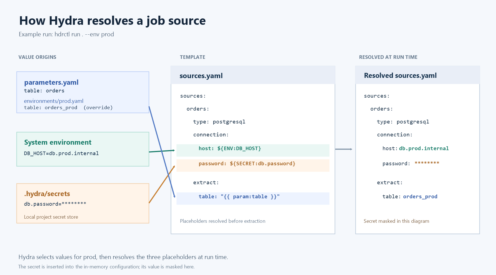
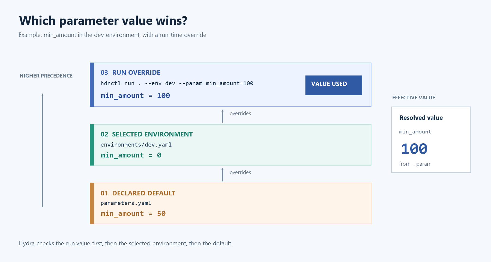
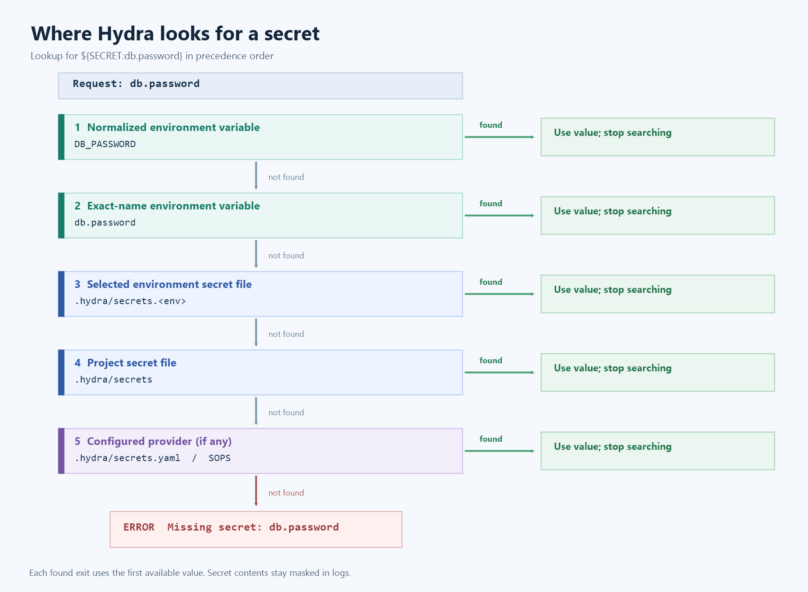

<!-- Hydra DSL White Paper — Chapter 5: Parameters and Secrets
     DSL format version: 1.0 · Hydra 0.18.0
     Sources: internal/config/{parameters,secrets,env_loader}.py, internal/runner/executor.py
     (_config_dirs, _load_parameters, resolution order), workflow/runner.py (_project_params,
     _resolve_action_params, _runtime_env_vars, _run_job), workflow/expr.py, cli/hdrctl.py
     (--env, --param, --secrets-file, init templates).
     0.18.0: internal/config/loader.py (hydra_home, apply_global_env, --env-file),
     internal/config/env_admin.py (hdrctl env|param|secret), secrets.py (.hydra/secrets.<env>),
     masking.py, secret_providers.py (SOPS, {env}) -->

# Hydra DSL - Parameters and Secrets

The same job often runs with different values: another date, another country, a test database instead of production. Hydra gives you four kinds of values that you write **once** and fill **at run time**:

| Kind                            | Written as         | Comes from                                                           | For                                             |
| ------------------------------- | ------------------ | -------------------------------------------------------------------- | ----------------------------------------------- |
| Parameter                       | `{{ param:NAME }}` | `parameters.yaml`, `environments/<env>.yaml`, `--param`, `set_param` | Business values: dates, thresholds, table names |
| Environment variable            | `{{ env:NAME }}`   | `~/.hydra/env`, `~/.hydra/env.<env>`, `.env` files, the system       | Machine settings                                |
| Environment variable (required) | `${ENV:NAME}`      | Same                                                                 | Machine settings that must exist                |
| Secret                          | `${SECRET:NAME}`   | Environment, `.hydra/secrets.<env>`, `.hydra/secrets`, SOPS          | Passwords, tokens, keys                         |

An **environment** (`dev`, `prod`…) selects one set of each: parameter values, global variables and secrets. Each kind is managed from the command line (`hdrctl param`, `hdrctl env`, `hdrctl secret`) or from Hydra Studio.



---

# Hydra DSL - Parameters

## Declaring parameters

Parameters are declared in `parameters.yaml`, at the root of the project:

```yaml
# parameters.yaml
version: "1.0"
parameters:
  min_amount:
    type: float
    default: 50
    description: Orders below this amount are dropped.
  country:
    type: str
    required: true
  batch_size:
    type: int
    default: 10000
```

| Key           | Default | Description                                                              |
| ------------- | ------- | ------------------------------------------------------------------------ |
| `type`        | `any`   | `int` · `float` · `str` / `string` · `bool` / `boolean` · `json` · `any` |
| `default`     | –       | Value used when nothing else gives one                                   |
| `required`    | `false` | `true`: the run stops if no value is given                               |
| `description` | –       | Free text                                                                |

Short form: `country: FR` (a value instead of a mapping) declares a parameter of type `any` with that default.

From the command line, `hdrctl param set` writes the same file:

```bash
hdrctl param set min_amount 50 --type float --description "Orders below this amount are dropped."
hdrctl param set country --type string --required
hdrctl param list
```

## Using parameters

```yaml
# transformations.yaml
version: "1.0"
transformations:
  steps:
    - filter:
        expr: "amount >= {{ param:min_amount }} and country == '{{ param:country }}'"
```

```yaml
# sources.yaml
sources:
  orders:
    type: postgresql
    connection: { ... }
    extract:
      table: "orders_{{ param:country }}"
      batch_size: "{{ param:batch_size }}"
```

## Rules for parameters

- `{{ param:NAME }}` works in every job file and in the `params` and `when` of workflow steps.
- Spaces inside the braces are allowed: `{{param:x}}` and `{{ param:x }}` are the same.
- A placeholder **alone** in a value keeps the type: `batch_size: "{{ param:batch_size }}"` gives the number `10000`.
- A placeholder **inside** a text is replaced as text: `"orders_{{ param:country }}"` gives `"orders_FR"`.
- A `{{ param:NAME }}` naming an unknown parameter stops the run before anything is read or written. Use `required: true` to also stop when a declared parameter has no value.
- A value that does not match `type` stops the run.
- A value given for a parameter that is not declared is accepted, as `any`.

### Booleans

For `type: bool`, these values are accepted:

| True                  | False                  |
| --------------------- | ---------------------- |
| `true` `1` `yes` `on` | `false` `0` `no` `off` |

### JSON

```yaml
parameters:
  regions:
    type: json
    default: '["north", "south"]'
```

The value is read as a list or a mapping.

---

# Hydra DSL - Environments

An **environment** is a set of values for the parameters: `dev`, `test`, `prod`… Each one is a file in `environments/`.

```yaml
# environments/dev.yaml
parameters:
  country: FR
  min_amount: 0
```

```yaml
# environments/prod.yaml
parameters:
  country: FR
  min_amount: 50
  batch_size: 50000
```

Select the environment when you run:

```bash
hdrctl run . --env dev
hdrctl run . --env prod
```

Or with the variable `HYDRA_ENV`:

```bash
HYDRA_ENV=prod hdrctl run .
```

`hdrctl workflow run <name> --env prod` works the same way. In Hydra Studio, the **Environment** selector on the project page and in the editor header applies to every run started from Studio; **Project settings › Parameters** shows one column per environment.

The values of one environment can also be written from the command line:

```bash
hdrctl param set min_amount 0 --env dev       # writes environments/dev.yaml
hdrctl param unset min_amount --env dev       # back to the default
```

An environment groups more than parameter values: its global variables (`~/.hydra/env.<env>`, next page) and its secrets (`.hydra/secrets.<env>`). `hdrctl env create | rename | delete <name>` handles all of them at once; `rename` and `delete` first copy the files to `~/.hydra/_backups/`.

## Overriding one value

`--param` (or `-P`) gives a value for one run. It can be repeated:

```bash
hdrctl run . --env prod --param min_amount=100 --param country=BE
```

## Which value wins?

From the strongest to the weakest:

| #   | Source                                                                               |
| --- | ------------------------------------------------------------------------------------ |
| 1   | Values set during the run: `--param`, and `set_param` / `assign_param` in a workflow |
| 2   | `environments/<env>.yaml` of the selected environment                                |
| 3   | `default` in `parameters.yaml`                                                       |



## Rules for environments

- Without `--env` and without `HYDRA_ENV`, only the defaults and the run values are used.
- `parameters.yaml` and `environments/` can also be placed in a job folder or in `workflows/`. The file **closest to the job** wins.
- A job run by a workflow receives the parameters created by `set_param` earlier in that workflow.

## Example: one workflow, two environments

```yaml
# workflows/daily.yaml
version: "1.0"
workflow:
  name: daily
  steps:
    - name: load
      type: job
      job: ../jobs/orders
    - name: publish
      type: job
      job: ../jobs/publish
      depends_on: [load]
      when: "{{ param:publish_enabled }} == True"
```

```yaml
# environments/dev.yaml
parameters:
  publish_enabled: false
```

```yaml
# environments/prod.yaml
parameters:
  publish_enabled: true
```

In `dev`, the `publish` step is skipped; in `prod`, it runs.

[**[LAB lab-05-01 · Killercoda]** **One project, three environments** —](https://killercoda.com/hydra-etl/scenario/26-one-project-three-environments)


> **[GITHUB gh-05-01 · example]** **project_environments** — Project with `parameters.yaml`, `environments/dev.yaml` and `environments/prod.yaml`, two jobs and one workflow using `{{ param: }}` in sources, transformations and `when`.


[**[GITHUB gh-05-01 · example]** **project_environments** —](https://github.com/bejaouibechir/bejaouibechir.github.io/tree/main/codes/05-parameters-secrets/project_environments)


---

# Hydra DSL - Environment Variables

## Two notations

| Notation         | If the variable is missing                              |
| ---------------- | ------------------------------------------------------- |
| `${ENV:NAME}`    | The run **stops**: `Missing environment variable: NAME` |
| `{{ env:NAME }}` | Not checked: no error, no value                         |

Use `${ENV:NAME}` for anything the job cannot work without.

```yaml
sources:
  crm:
    type: mysql
    connection:
      host: ${ENV:CRM_HOST}
      port: ${ENV:CRM_PORT}
      user: etl
      password: ${SECRET:crm.password}
      database: crm
```

```yaml
- name: log_host
  type: action
  action: log
  params:
    message: "Running on {{ env:HOSTNAME }}"
```

## Global variables

Variables shared by **every project of the machine** live in your home folder:

| File                 | Applies to                    |
| -------------------- | ----------------------------- |
| `~/.hydra/env`       | Every environment             |
| `~/.hydra/env.<env>` | The selected environment only |

```bash
hdrctl env set CRM_HOST crm.internal              # ~/.hydra/env
hdrctl env set CRM_DATABASE crm_prod --env prod   # ~/.hydra/env.prod
hdrctl env show prod
```

In Hydra Studio: **Global settings › Environments**. `HYDRA_HOME` moves the folder (default `~/.hydra`). When a run switches environment (Studio, API), the variables of the previous environment are removed first.

## .env files

Hydra also loads `.env` files before a job runs. All the layers, from the strongest to the weakest:

| #   | Source                                                 |
| --- | ------------------------------------------------------ |
| 1   | `--env-file <file>` (or `HYDRA_ENV_FILE`), for one run |
| 2   | `.env` in the job folder                               |
| 3   | `.env` at the project root (the folder with `.hydra/`) |
| 4   | `~/.hydra/env.<env>`                                   |
| 5   | `~/.hydra/env`                                         |
| 6   | Variables already set in the system                    |

```bash
# jobs/crm/.env
CRM_HOST=localhost
CRM_PORT=3306
```

One `NAME=value` per line. Never put secrets in a `.env` file that is committed. A missing `--env-file` stops the run.

---

# Hydra DSL - Secrets

## Using a secret

```yaml
password: ${SECRET:db.password}
```

A secret can be used anywhere a value is written: in `connection`, in `headers` of a webhook, in the `password` of an email or SSH action…

## Where Hydra looks for a secret

For `${SECRET:db.password}`, in this order:

| #   | Looks for                                                                                | Example               |
| --- | ---------------------------------------------------------------------------------------- | --------------------- |
| 1   | An environment variable with the **normalised** name: `.` and `-` become `_`, upper case | `DB_PASSWORD`         |
| 2   | An environment variable with the exact name                                              | `db.password`         |
| 3   | The secrets file of the selected environment                                             | `.hydra/secrets.prod` |
| 4   | The project secrets file                                                                 | `.hydra/secrets`      |
| 5   | The provider of `.hydra/secrets.yaml` (SOPS)                                             | `provider: sops`      |

The environment always wins over the files. Locally you use the file; in production (CI, vault, container), you set the variable and change nothing in the YAML.



## The secrets file

`hdrctl init` creates `.hydra/secrets` and adds it to `.gitignore`.

```bash
# .hydra/secrets
# One per line: name=value. Lines starting with # are ignored.
db.password=change-me
api.token="abc 123"
export smtp.password=s3cret
```

Secrets of one environment go in `.hydra/secrets.<env>`, same format, also ignored by git. With `--env prod`, a name found in `.hydra/secrets.prod` wins over `.hydra/secrets`; the other names still come from `.hydra/secrets`.

```bash
hdrctl secret set db.password                 # typed hidden, twice
hdrctl secret set db.password --env prod      # .hydra/secrets.prod
echo "$PW" | hdrctl secret set api.token --stdin
hdrctl secret list --env prod                 # names only
```

In Hydra Studio: **Project settings › Secrets**, common or per environment. No tool ever shows a value back: not the command line, Studio, the API or the MCP server.

## Rules for secrets

- One `name=value` per line. Names use letters, digits, `.`, `_`, `-`.
- Quotes around the value are removed. A leading `export` is accepted.
- A missing secret stops the run, naming the variable and the file it looked for. The message never shows a value.
- To keep the file outside the project: `HYDRA_SECRETS_FILE=/path/to/secrets`, or `hdrctl run . --secrets-file /path/to/secrets`.
- Never write a password, token or key in clear in a YAML file.

## Secrets in logs

Every secret value Hydra reads is **masked** in what it displays or keeps: logs, error messages, the output of `bash`, `powershell`, `python` and `ssh` actions, webhook and email log lines, undo reports and the runs stored by the API. The value sent to the connector or the script is never changed.

| `visibility` | What is displayed                              |
| ------------ | ---------------------------------------------- |
| `plain`      | The value, in clear (debugging only)           |
| `masked`     | `[MASKED]` in place of the value — **default** |
| `hidden`     | The line is left out and counted               |

Set it in `.hydra/secrets.yaml` (`visibility: hidden`), with `HYDRA_SECRETS_VISIBILITY`, or for one run with `--secrets-visibility`.

Limits: a value shorter than 4 characters is not masked (a warning names it); a secret that a script reads directly from the environment, or a transformed value (base64, split), is not masked.

## Encrypted secrets (SOPS)

`.hydra/secrets.yaml` holds settings, never a value, and can be committed:

```yaml
# .hydra/secrets.yaml
visibility: masked
provider: sops
sops:
  file: .hydra/secrets.{env}.sops.yaml   # {env} = the selected environment
  age_key_file: ~/.config/sops/age/keys.txt
```

The encrypted file is decrypted in memory only. `sops` and `age` must be installed.

## Example: the same job, local and production

```yaml
# jobs/sync/destinations.yaml
destinations:
  dwh:
    type: postgresql
    connection:
      host: ${ENV:DWH_HOST}
      port: 5432
      user: etl
      password: ${SECRET:dwh.password}
      database: dwh
    load:
      table: "sales_{{ param:country }}"
      mode: replace
```

Locally:

```bash
# jobs/sync/.env
DWH_HOST=localhost
```

```bash
# .hydra/secrets
dwh.password=local-dev-password
```

```bash
hdrctl run . --env dev
```

In production, either keep a `.hydra/secrets.prod` on the server, or let the platform set the variables — nothing changes in the files:

```bash
export DWH_HOST=dwh.prod.internal
export DWH_PASSWORD=********
hdrctl run . --env prod
```


[**[LAB lab-05-02 · Killercoda]** **Secrets without leaks** —](https://killercoda.com/hydra-etl/scenario/27-secrets-without-leaks)


---

# Hydra DSL - Values in Scripts

Parameters reach the scripts of a workflow in two ways.

| Where                                         | How                                                                                                   |
| --------------------------------------------- | ----------------------------------------------------------------------------------------------------- |
| `bash`, `powershell`, `ssh`, `python` actions | As environment variables with the parameter name: `$country`, `$env:country`, `os.environ["country"]` |
| `script` transformation                       | In the read-only mapping `params`: `params["min_amount"]`                                             |
| Any action `params`                           | As `{{ param:NAME }}`, replaced before the action runs                                                |

- Only names made of letters, digits and `_` are passed as environment variables.
- Booleans are passed as `true` / `false`.

```yaml
- name: export_country
  type: action
  action: bash
  params:
    command: 'echo "Exporting $country with threshold $min_amount"'
```

---

# Hydra DSL - Placeholder Summary

| Placeholder        | Resolved in                                      | Missing value      | Type kept       |
| ------------------ | ------------------------------------------------ | ------------------ | --------------- |
| `{{ param:NAME }}` | Job files, step `params`, `when`, action scripts | Error if unknown   | Yes, when alone |
| `{{ env:NAME }}`   | Job files, step `params`, `when`                 | No error, no value | –               |
| `${ENV:NAME}`      | Job files, step `params`                         | Error              | – (text)        |
| `${SECRET:NAME}`   | Job files, step `params`                         | Error              | – (text)        |

Where each value lives, and how to manage it:

| Kind                  | Files                                          | Command line    | Hydra Studio                   |
| --------------------- | ---------------------------------------------- | --------------- | ------------------------------ |
| Parameters            | `parameters.yaml`, `environments/<env>.yaml`   | `hdrctl param`  | Project settings › Parameters  |
| Environment variables | `~/.hydra/env`, `~/.hydra/env.<env>`, `.env`   | `hdrctl env`    | Global settings › Environments |
| Secrets               | `.hydra/secrets`, `.hydra/secrets.<env>`, SOPS | `hdrctl secret` | Project settings › Secrets     |

Order of resolution in a job file: `${ENV:…}` and `${SECRET:…}` first, then `{{ param:… }}` and `{{ env:… }}`.
