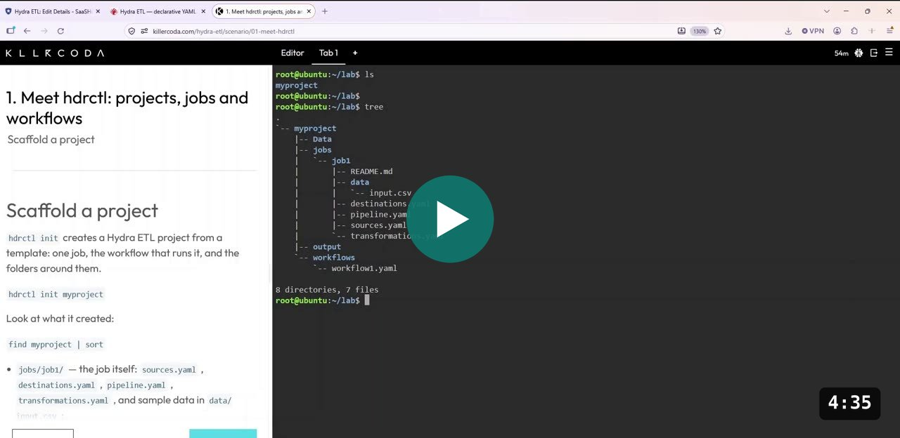
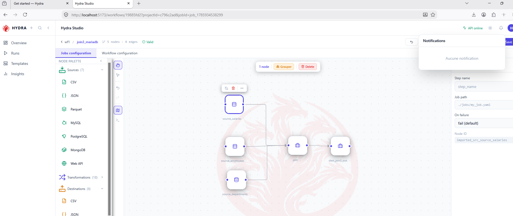
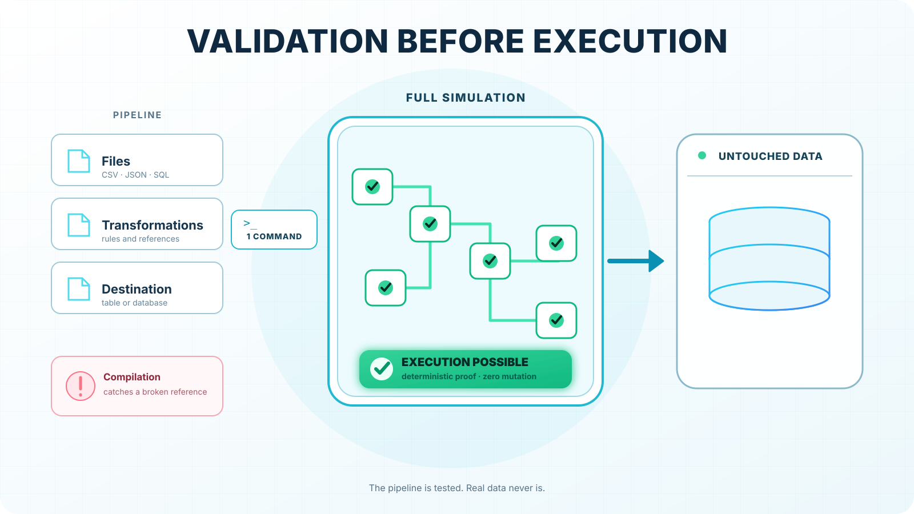
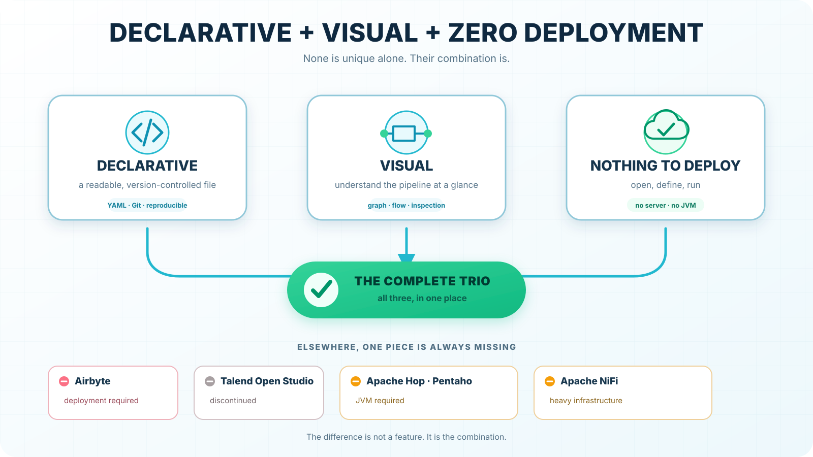
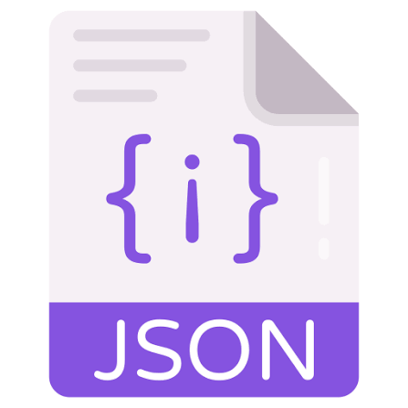
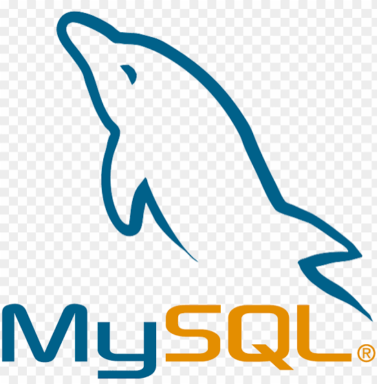
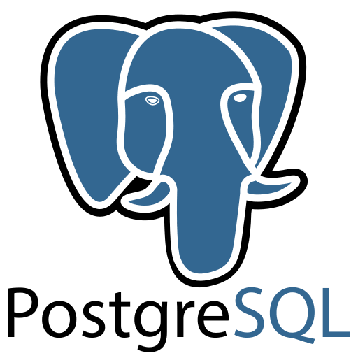
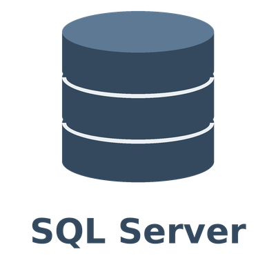
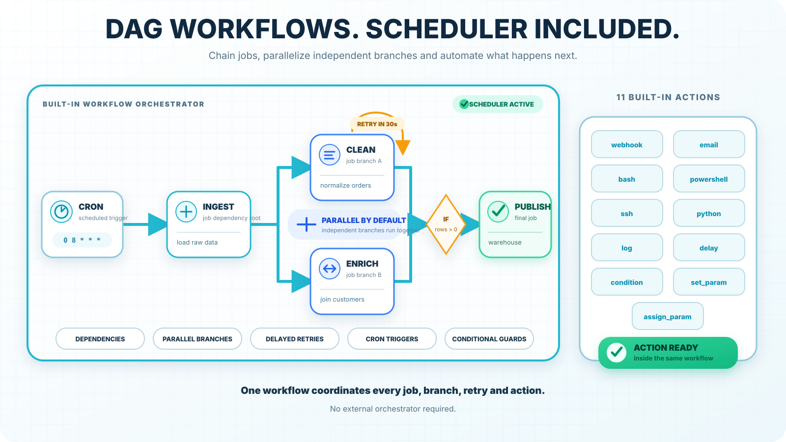
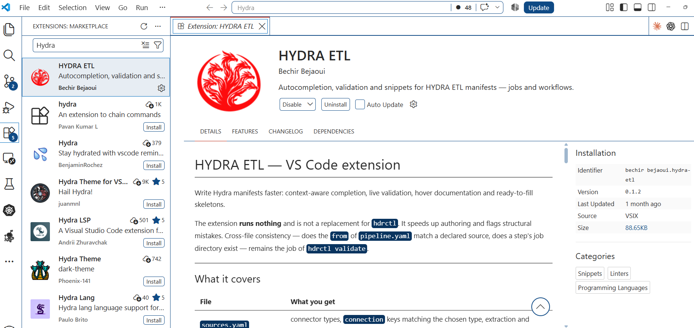

# Hydra ETL

**Your data pipelines are described, not programmed.**

[](https://github.com/bejaouibechir/Hydra/actions/workflows/ci.yml)
[](https://pypi.org/project/hydra-etl/)
[](https://pypi.org/project/hydra-etl/)
[](LICENSE)
[](#project-status)
[](https://glama.ai/mcp/servers/bejaouibechir/Hydra)
<a href="https://www.saashub.com/hydra-etl?utm_source=badge&utm_campaign=badge&utm_content=hydra-etl&badge_variant=color&badge_kind=approved"></a>

**[Website](https://hydraetl.com)** · **[Video tutorials](https://hydraetl.com/academy/?utm_source=github&utm_medium=readme&utm_campaign=academy)** · **[Docs & playground](https://hydraetl.com/playground)** · **[MCP server](docs/MCP.md)** · **[VS Code extension](#vs-code-extension)** · **[Changelog](CHANGELOG.md)**

<p align="center">
  <a href="https://youtu.be/9cCMWptQEgE"></a>
  <br>
  <sub>▶ Watch (4:35): create a project with <code>hdrctl init</code> and explore its structure. More videos in <a href="https://hydraetl.com/academy/?utm_source=github&amp;utm_medium=readme&amp;utm_campaign=academy">Hydra Academy</a>.</sub>
</p>

Hydra is an open-source declarative ETL engine. You write what a pipeline *is* in YAML;
Hydra validates it before touching any data, then runs it. The same manifests run from
the terminal, a REST API, or a visual editor in your browser, with one `pip install` and nothing else to deploy.

## Try it without installing anything

Two sandboxes run Hydra in your browser. Nothing is installed on your machine,
and nothing is left behind when you close the tab.

### Guided labs — no account needed

**[killercoda.com/hydra-etl](https://killercoda.com/hydra-etl)**

Killercoda gives you a Linux terminal inside your browser, next to a short
lesson that tells you exactly what to type. Each lab takes ten to fifteen
minutes and checks your work as you go. There is nothing to sign up for.

Start with *Meet hdrctl* to see what a job is, then *Parameters and secrets* to
run one pipeline against two databases.

### A full environment, with the visual editor

[](https://codespaces.new/bejaouibechir/hydra-demo)

GitHub Codespaces starts a real machine in the cloud and opens an editor in your
browser. It needs a free GitHub account, and it runs within GitHub's free
monthly allowance.

This one comes with a MySQL database already running beside it and a working
pipeline. **Once it opens, type `./tour`** — a five-minute walkthrough that
shows you each command before running it. It is the only thing you have to type.

Unlike the labs, this environment includes **Hydra Studio**, the visual editor,
so you can see the same pipeline as a diagram and run it from there.

<!-- TODO: replace with a short GIF: build a job in Studio → hdrctl validate → hdrctl run -->



---

## Quick start

```bash
pip install "hydra-etl[server]"
hdrctl serve --open            # Studio + API on http://localhost:5678
```

Or stay in the terminal:

```bash
hdrctl init my_project                 # or `hdrctl init .` in an empty folder
hdrctl run my_project --dry-run        # validate the whole project, run nothing
hdrctl run my_project                  # run every workflow (or `hdrctl run .` from inside)
hdrctl validate my_project/jobs/job1   # strict validation of one job, no data touched
hdrctl run my_project/jobs/job1        # run one job alone
```

A project is a set of workflows; a workflow is a set of jobs and actions.

`init` scaffolds a full project:

```
my_project
├── .gitignore           keeps .hydra/secrets and .env out of git
├── .hydra/              project marker, Studio data, and secrets (name=value, git-ignored)
├── Data/                input data
├── environments/        parameter values per environment (dev.yaml, prod.yaml…)
├── jobs/
│   └── job1/
│       ├── README.md
│       ├── data/input.csv
│       ├── destinations.yaml
│       ├── pipeline.yaml
│       ├── sources.yaml
│       └── transformations.yaml
├── outputs/             files produced by the jobs
├── parameters.yaml      project parameters, used as {{ param:NAME }}
├── README.md
├── scripts/             scripts called by workflow actions
└── workflows/
    ├── thread.yaml      execution order of the workflows
    └── workflow1.yaml
```

Six job templates are available with `--template` (`basic`, `csv`, `mysql`, `postgres`, `api`,
`mongodb`). `workflows/thread.yaml` lists the workflows in stages, each `sequential` or `parallel`,
with an optional `delay_after`, and per workflow an `active` flag, an optional `delay_before` and
an optional `timeout`:

```yaml
version: "1.0"
thread:
  - mode: sequential
    delay_after: 30s          # optional pause before the next stage
    workflows:
      - name: workflow1
        timeout: 30m          # optional: beyond it, the workflow fails
      - name: workflow2
        active: false         # skipped, without removing it
  - mode: parallel
    workflows:
      - name: export-a
      - name: export-b
        delay_before: 23s     # starts 23 s after the stage (staggered start)
loops:                        # optional
  - from: export-b            # when export-b finishes…
    to: workflow1             # …go back to workflow1
    times: 3                  # 3 passes in total
    delay: 5m                 # optional pause before each repeat
```

`delay_before` waits before starting a workflow: in a sequential stage, after the previous
workflow; in a parallel stage, after the stage starts. Same format as `delay_after` (`500ms`,
`30s`, `5m`, `1h`, or seconds). Fallback conditions are checked after the wait. In a parallel
stage, a failed workflow cancels the starts still waiting.

`timeout` is the longest a workflow may run (same format, more than 0). Beyond it, the workflow
is stopped at the next step or batch — an all-or-nothing load is cancelled, an action already
started finishes (it has its own `timeout`) — and counts as failed:
`✗ Workflow 'load_crm' failed (30.0s): timed out after 30s`. It also applies to each backup run
in its place.

A loop can link any two workflows of the thread (`to` comes before `from`, or is the same
workflow); loops must not overlap.

A workflow can declare a **fallback**: one or more backup workflows, kept outside the thread,
that take its place when a condition is true just before the start, or after it fails:

```yaml
      - name: load_crm
        fallback:
          use: [load_crm_backup]                    # tried in order
          when: "not source_available('crm_db')"    # checked just before the start
          on_failure: true                          # also after a failure
```

`when` uses a small closed language (never Python `eval`): `source_available('name')`,
`destination_available('name')`, `file_exists('path')`, `file_size('path')`, `file_age('path')`,
`url_ok('url')`, `secret_defined('name')`, `db.load('name')`, `previous.status`, `previous.rows`,
with `and`, `or`, `not`, comparisons, durations (`30s`, `24h`) and sizes (`5MB`).
`hdrctl workflow add load_crm_backup --fallback-for load_crm` creates a backup workflow and
declares it. `hdrctl run . --dry-run` checks the fallbacks (files, jobs, names used by `when`)
and warns when a backup writes somewhere else than the workflow it replaces.

At run time, `when` is checked **just before** the workflow starts. Each check is quick, reads
no data and has a time limit (`HYDRA_PROBE_TIMEOUT`, 15 s by default). If the condition is
true, the first backup runs **in its place** (same stage, same loop pass) and the reason is
shown: `↪ Fallback: load_crm → load_crm_backup — source_available('crm_db') = false (connection
refused)`. If a check cannot answer (time limit, missing file for `file_size`…), the planned
workflow runs (`on_probe_error: keep`, the default) or the backup does (`replace`). An inactive
workflow is not checked. `hdrctl run . --use-fallback load_crm` forces the switch, to rehearse a
recovery.

With `on_failure: true`, a workflow that fails (or exceeds its `timeout`) is replaced by its
first backup **only if it left nothing published**: no load published and no outside action
done (`webhook`, `email`, `bash`, `python`… except those marked `undo: none`), or everything
undone by `rollback: true`. The backup then cannot write the same data twice. If the backup
fails too, the next one in `use` runs. Otherwise the project stops and says why:
`⛔ load_crm: fallback load_crm_backup not started — step 'load1' had already published its data`.
`hdrctl run . --dry-run` warns when a workflow with `on_failure` publishes in several steps
without `rollback: true`.

In Studio, **Settings › Project settings** (button **Project settings** on the project page)
edits the same file (**Execution order** → **Define**), draws it (**Preview**) and checks it
(**Check**); the project page keeps the workflows and a **Run project** button.
The life-buoy button of a workflow edits its fallback: backup workflows (one taken from the
thread leaves it), the `when` condition, checked as you type, with a helper that inserts a
function and a source or destination of the project, and `on_probe_error`. **Preview** draws
each backup as a dashed block under its workflow, with the condition on the link; **Check**
shows the warnings; the run page tells which workflow ran, the backup or not, and why: a
workflow replaced after a failure shows *replaced by …*, a stopped one *timed out*, a blocked
switch *fallback blocked* with the reason. The **max** field of a workflow line sets its
`timeout` (⏳ in the Preview).
The **wait** field of each workflow line sets its `delay_before`; **Preview** shows it as a
clock above the block and the run page as a *waited …* badge on the step.
`hdrctl run <project>` checks the thread, every active workflow and the job folders they use
before starting anything, then runs the stages in order. A failed workflow stops the project;
in a parallel stage the workflows already started finish first. Without `thread.yaml`, every
`workflows/*.yaml` runs one after the other, in alphabetical order. Parameters come from the
project's `parameters.yaml`, `environments/<env>.yaml` (`--env`) and `-P KEY=VALUE`, in that
order of precedence. Workflow triggers (`schedule`, `webhook`) are ignored by `hdrctl run`;
they apply under `hdrctl serve`.

No Node, no build step, no database, no message broker. Python 3.9+ on Linux, macOS or Windows.

---

## Why Hydra

- **Validate before you run.** `hdrctl validate` checks sources, steps, types and destinations
  deterministically, before any data is read or written.
- **Declarative, visual, zero deployment.** YAML manifests, a browser editor that outputs the same YAML,
  and a single Python process. No cluster, no JVM, no container required.
- **Built for CI/CD.** Manifests are versioned and reviewed like code; `hdrctl` scaffolds, validates,
  tests and runs from a terminal or a CI job.
- **Built-in scheduler.** DAG workflows with dependencies, parallel branches, delayed retries, cron triggers,
  conditional guards and eleven actions (webhook, email, Bash, PowerShell, SSH, Python…).
- **One job, many environments.** `{{ param: }}`, `{{ env: }}` and `${SECRET:}` keep the manifest identical
  across dev, staging and production.
- **Two engines per operation.** pandas or DuckDB, chosen step by step, with optional Rust acceleration
  (see [Native acceleration](#native-acceleration-optional)).
- **AI-ready.** An MCP server lets Claude, Cursor or VS Code write pipelines that Hydra validates.

<p>
  
  
</p>

### How it compares

|                      | Hydra                    | Airflow                           | dbt                        | Airbyte             | NiFi / Apache Hop        |
| -------------------- | ------------------------ | --------------------------------- | -------------------------- | ------------------- | ------------------------ |
| Pipelines defined in | YAML                     | Python                            | SQL + YAML                 | UI / config         | UI flows                 |
| Scope                | Extract, transform, load | Orchestration                     | Transform in the warehouse | Extract & load      | Extract, transform, load |
| Visual editor        | Included                 | Monitoring UI                     | Not in dbt Core            | Included            | Included                 |
| To get started       | `pip install`            | Scheduler, webserver, metadata DB | A data warehouse           | Docker / Kubernetes | JVM                      |

Hydra is not a replacement for all of these. It targets file-and-database pipelines that should stay
readable and run without extra infrastructure.

---

## What you get

| Component     | Description                                                              |
| ------------- | ------------------------------------------------------------------------ |
| **Engine**    | Declarative jobs: one source, N transformations, one destination         |
| **CLI**       | `hdrctl`: scaffold, validate, run, inspect. English and Spanish          |
| **API**       | FastAPI, with interactive docs at `/docs`                                |
| **Studio**    | Visual editor for jobs and workflows; opens an existing project folder   |
| **Workflows** | Multi-job DAG with dependencies, actions, retries and runtime parameters |
| **MCP**       | Natural-language pipeline authoring, validated by Hydra                  |

**Connectors** (sources and destinations):

| <br>CSV | <br>JSON | <br>Parquet | <br>MySQL / MariaDB | <br>PostgreSQL | <br>SQL Server | <br>MongoDB | <br>Web API |
|:--------------------------------------------------------------:|:----------------------------------------------------------------:|:----------------------------------------------------------------------:|:----------------------------------------------------------------------------:|:----------------------------------------------------------------------------:|:---------------------------------------------------------------------------:|:--------------------------------------------------------------------:|:------------------------------------------------------------------:|

**Transformation engines:** pandas and DuckDB.

---

## Who it is for

- **Data engineers and analysts** who need repeatable file-and-database pipelines without standing up
  infrastructure for them.
- **Teams where pipelines must stay readable** by people who do not write Python: a YAML manifest
  reviewed in a pull request, not a script.
- **Developers embedding ETL in a product**, who want a CLI and a REST API over the same engine.

---

## A job in four files

A job is a folder. Four manifests describe it, and each one answers a single question.

**`sources.yaml`**: where the data comes from

```yaml
version: "1.0"
sources:
  src_input:
    type: csv
    extract:
      table: ./input.csv
```

**`transformations.yaml`**: how it is reshaped

```yaml
version: "1.0"
steps:
  - cast:
      mapping:
        amount: float
  - filter:
      expr: "amount > 0"
  - aggregate:
      by: [name]
      agg:
        total: { func: sum, col: amount }
```

A CSV carries no types, so `cast` comes before any numeric comparison.

**`destinations.yaml`**: where it goes

```yaml
version: "1.0"
destinations:
  dest_output:
    type: csv
    load:
      table: ./output.csv
      mode: replace          # append | replace | upsert
      # atomic: true         # all-or-nothing (see below)
```

**All-or-nothing load.** A job writes its destination in one go: nothing is visible before the
end, and a failure (or Ctrl+C) leaves the destination as it was. It is on by default where it
costs nothing:

| Destination | `replace` | `append` | `upsert` |
|---|---|---|---|
| PostgreSQL, SQL Server | one transaction (TRUNCATE inside it) | `atomic: true` | `atomic: true` |
| MySQL / MariaDB | one transaction (DELETE, InnoDB table) | `atomic: true` | `atomic: true` |
| CSV | temporary file, then swapped | back to the original size | — |
| Parquet | temporary file, then swapped | temporary file, then swapped | — |

`atomic: true` makes `append` / `upsert` into a database one transaction too (longer locks, a
larger database log: fine for medium volumes); `atomic: false` goes back to batch-by-batch
commits. `atomic: true` where it cannot work (MongoDB, web API, a MyISAM table) is an error,
never a silent downgrade. In PostgreSQL, readers of a table being replaced wait for the end of
the job instead of seeing it empty. Temporary files left by a crashed run are removed on the
next run.

**`pipeline.yaml`**: which source feeds which destination

```yaml
version: "1.0"
pipeline:
  from: src_input
  to: dest_output
```

```bash
hdrctl validate my_job && hdrctl run my_job
```

---

## Workflows: order several jobs

```yaml
version: "1.0"
workflow:
  name: daily_etl
  trigger:
    type: schedule
    cron: "0 8 * * *"
  steps:
    - name: extract
      type: job
      job: ./jobs/extract
      depends_on: []

    - name: transform
      type: job
      job: ./jobs/transform
      depends_on: ["extract"]     # always a list, supports fan-in

    - name: notify
      type: action
      action: webhook
      params: { url: "{{ env:WEBHOOK_URL }}" }
      depends_on: ["transform"]
      on_failure: skip
```

```bash
hdrctl workflow add daily_sales        # new empty workflow, added at the end of thread.yaml
hdrctl workflow list                   # workflows in thread order: stage, active/inactive, steps
hdrctl workflow validate daily_sales   # by name inside a project, or by file path
hdrctl workflow run daily_sales        # one workflow
hdrctl workflow remove daily_sales     # deletes the file and its thread entry; jobs are kept
hdrctl run .                           # every workflow, in the order of thread.yaml
```

**Rollback.** With `rollback: true`, a workflow that fails undoes the steps it has already
done, the last one first. Jobs are undone automatically: the previous file comes back (it is
kept next to the new one until the end of the run), a replaced table gets its previous content
back (a copy `hydra_bak_…` taken before the load), the rows added by `append` / `upsert` are
removed and the rows changed by `upsert` get their old values. Actions that act outside Hydra
(`webhook`, `email`, `bash`, `powershell`, `ssh`, `python`) say how to reverse them:

```yaml
workflow:
  name: daily_sales
  rollback: true
  steps:
    - name: load
      type: job
      job: ../jobs/load_sales        # database append: load.key is required
    - name: publish
      type: action
      action: bash
      params: { command: "cp outputs/sales.csv /mnt/share/" }
      undo:
        action: bash
        params: { command: "rm -f /mnt/share/sales.csv" }
      depends_on: [load]
    - name: notify
      type: action
      action: email
      params: { to: team@example.com }
      undo: none                     # nothing to reverse
      depends_on: [publish]
```

Everything is checked before the run (`hdrctl workflow validate`, `hdrctl run --dry-run`,
Studio's **Check**). A destination that changed since the run wrote it (another program
wrote there) is not undone: the rollback stops instead of erasing that work. A rollback that
stops (or a crash) leaves `.hydra/undo/<workflow>.json`; the workflow then refuses to run until
`hdrctl workflow undo <workflow>` finishes it. In Studio: **Rollback on/off** in the workflow
toolbar, **Undo** in the settings of an action, undone steps marked in the run page.

Jobs are added to a workflow as a chain: each step runs after the previous one.

```bash
hdrctl job add load_orders                    # new job jobs/load_orders/, attached nowhere
hdrctl job add load_orders daily_sales        # new job, appended to the workflow
hdrctl job attach clean_orders daily_sales -p 1   # existing job, as step 1: the old step 1 now runs after it
hdrctl job detach clean_orders daily_sales    # the next step inherits its dependencies; the folder is kept
hdrctl job detach clean_orders                # from every workflow
hdrctl job list                               # each job: free, or the workflows it is in
```

`job add` uses the same templates as `init` (`--template mysql`, `postgres`…). These commands rewrite
the workflow file (comments in it are not kept) and refuse any change that would leave it invalid.

The `workflow` commands work on the project that contains the current folder, or on the one given
with `--project <path>`; outside a project they stop with an error. Studio keeps `thread.yaml` in
step too: a workflow created or deleted in Studio is added to or removed from it.

An edge is a **dependency**, not a pipe: it decides *when* a job runs, never what data reaches it.
Steps that share no dependency run in parallel.



---

## Parameters

Values can be declared once and reused, or created while the workflow runs.

```yaml
- filter:
    expr: "region == '{{ param:region }}'"
```

`{{ param:NAME }}` reads a parameter and `{{ env:NAME }}` an environment variable.
`${SECRET:NAME}` reads a secret. It is looked up first in the environment, under the name upper-cased with
dots and dashes turned into underscores — so `${SECRET:db.password}` reads `DB_PASSWORD` (CI variables, a
secret manager, your shell, a `.env` file) — then in the project's `.hydra/secrets` file:

```
# .hydra/secrets — one name=value per line, listed in .gitignore by hdrctl init
db.password=change-me
api.token=abc123
```

In Studio, the **Secrets** tab of the workflow editor manages the same file (names only; values are never
sent back to the browser). To keep that file outside the project, point to it with `HYDRA_SECRETS_FILE=<path>` or
`hdrctl run . --secrets-file <path>`. The environment always wins over the file, so production can supply
the values without touching the project.
The `set_param` and `assign_param` actions create and change parameters mid-run, so two jobs can share a
placeholder and produce different results.

---

## Install what you need

The base install is the engine and the CLI. Everything else is opt-in.

```bash
pip install hydra-etl                  # engine + CLI
pip install "hydra-etl[server]"        # + API + Studio
pip install "hydra-etl[postgres]"      # + PostgreSQL driver
pip install "hydra-etl[mssql]"         # + Microsoft SQL Server driver
pip install "hydra-etl[all]"           # everything
```

Available extras: `server`, `native`, `duckdb`, `parquet`, `mysql`, `postgres`, `mssql`, `mongodb`, `http`, `mcp`, `all`.

### Or run it in a container — optional

Hydra needs no container: it stays one `pip install` and one Python process.
If your team standardises on containers, or you would rather keep Python off
the host, the image carries the engine, the CLI, the API and the Studio:

```bash
docker run --rm -p 5678:5678 -v hydra-workspace:/workspace \
  ghcr.io/bejaouibechir/hydra:latest
```

Building it yourself, per system: [Linux](GHCR/README.md#linux) ·
[Windows](GHCR/README.md#windows) · [macOS](GHCR/README.md#macos).

---

## Serving

```bash
hdrctl serve                 # Studio and API on port 5678
hdrctl serve --open          # and open the browser
hdrctl serve --no-studio     # API only, for a headless server
hdrctl serve --port 8080
```

The server writes projects into the directory you launch it from. Interactive API docs are at `/docs`.

---

## Your AI assistant, connected (MCP)

Hydra ships an MCP server. Point Claude Desktop, Cursor, VS Code or any MCP client at it, and ask for a
pipeline in plain language.

```bash
pip install "hydra-etl[mcp]"
hydra-mcp
```

Your assistant writes the manifests; **Hydra validates them before anything is written**, and nothing runs
until you ask. Requires Python 3.10+. See [docs/MCP.md](docs/MCP.md) for client configuration.

Graded by [Glama](https://glama.ai/mcp/servers/bejaouibechir/Hydra), which builds the server in a
sandbox, runs security checks and scores the tool definitions:

[](https://glama.ai/mcp/servers/bejaouibechir/Hydra)

---

## Native acceleration (optional)

Parts of the engine have a Rust implementation. It is optional and off by default: without it, Hydra
behaves exactly the same.

```bash
pip install "hydra-etl[native]"
HYDRA_BACKEND=rust hdrctl run ./jobs/sales
```

Or per operation, with a `hydra.backends.yaml` file next to the job:

```yaml
default: python
overrides:
  csv.read: rust      # currently the only accelerated operation
```

On one million rows, CSV reading is about four times faster, with byte-for-byte identical results
(parity checked on 26,000 CSV files and one million floats against CPython `repr()`). Hydra falls back to
Python automatically whenever that guarantee cannot be kept. Benchmarks: [`bench/`](bench/).

---

## Large-volume engine (optional)

pandas stays the reference engine. Above about two million rows, a job with a global operation
(`aggregate`, `sort`…) can switch two steps to faster engines, with the same results:

- CSV reading with pyarrow (C++, several cores), in large batches;
- `aggregate` and `sort` in a temporary DuckDB database on disk, instead of gathering every row in memory.
  Row-by-row steps (`filter`, `cast`, inner `join`, `calculate`…) still run in pandas, batch by batch.

```bash
pip install "hydra-etl[duckdb]"
hdrctl run . --profile          # the profile shows the engine chosen and why
```

`engine: auto` (default) picks DuckDB when the job has a global operation and the CSV source holds
more than `HYDRA_LARGE_VOLUME_ROWS` estimated rows (2,000,000); `pandas` or `duckdb` force the choice.
Set it per job in `transformations.yaml` (Studio: **Engine** selector of a job), or for a whole run with
the `HYDRA_ENGINE` variable, which takes precedence:

```yaml
engine: auto          # auto | pandas | duckdb
steps:
  - aggregate: {by: [country], agg: {revenue: {func: sum, col: amount}}}
```

A global operation DuckDB cannot translate is handed back to pandas, with a log message; the fast CSV
reader hands over to the Python reader (irregular row, BOM, duplicate header, non-UTF-8 encoding),
with a warning. Parity tests: `tests/test_large_volume.py`.

Measured on 2 CPUs / 8 GB (orders → customers join → revenue by country and by month, two jobs):

| Rows | pandas | large-volume engine | dlt + dbt (DuckDB) |
|---|---|---|---|
| 5 M | 26.8 s · 1.4 GB | **8.9 s** · 0.86 GB | 19.8 s · 0.55 GB |
| 10 M | 65.0 s · 2.7 GB | **17.3 s** · 1.0 GB | 28.3 s · 0.69 GB |
| 20 M | 112.8 s · 5.4 GB | **34.3 s** · 1.4 GB | 46.2 s · 0.79 GB |

---

## VS Code extension

Completion and validation for Hydra manifests inside the editor, without installing Hydra.
Download the `.vsix` from the [latest release](https://github.com/bejaouibechir/Hydra/releases/latest),
or build it yourself from [`vscode-extension/`](vscode-extension/) (`python build_vsix.py`, no Node required).



---

## Project status

**Beta.** The documented connectors and steps are implemented and covered by tests. The shape of the YAML
DSL is settled; any breaking change will be announced in the release notes before 1.0.
Use it on real work, and pin your version.

---

## Contributing

Issues, ideas and pull requests are welcome. See [CONTRIBUTING.md](CONTRIBUTING.md).
If Hydra is useful to you, a ⭐ on GitHub helps others find it.

---

# License

Hydra ETL is open source under the **GNU Affero General Public License v3.0 or later (AGPL-3.0-or-later)**.

## You can, for free

- Use Hydra ETL for any purpose, including inside a company and for commercial work.
- Run your own pipelines with it, internally or for clients.
- Modify it and redistribute it.

Using Hydra ETL to move **your** data does not make your data, your YAML pipelines or your other applications subject to the AGPL.

## The one obligation

If you **modify Hydra ETL itself** and make it available to others — including over a network, for example as a hosted service — you must publish your modified source code under the same license.

## Commercial license

If that obligation does not fit your case — typically, you embed a modified Hydra ETL in a proprietary product or offer it as a service without publishing your changes — a commercial license is available.

**Contact:** admin@hydraetl.com — reply within 2 business days.

## Support and services

- Support with response time commitments
- Help migrating existing scripts or tools to Hydra ETL
