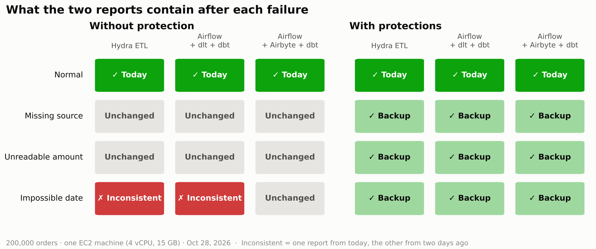
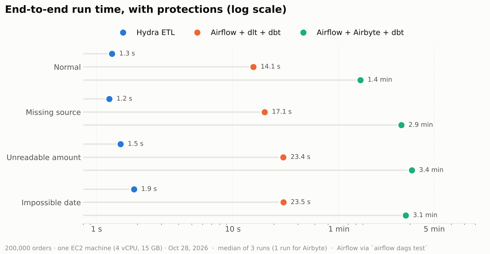
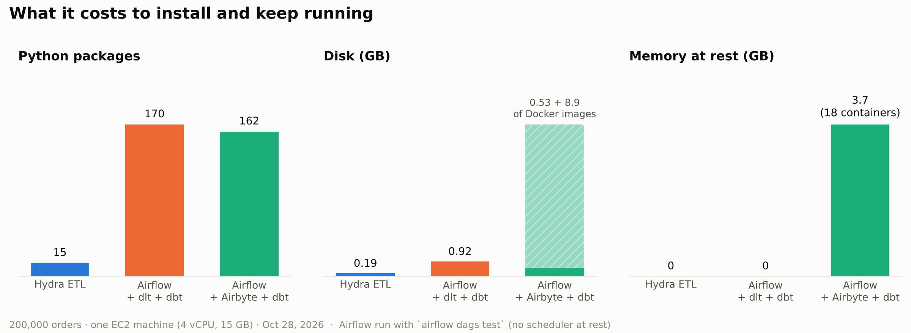
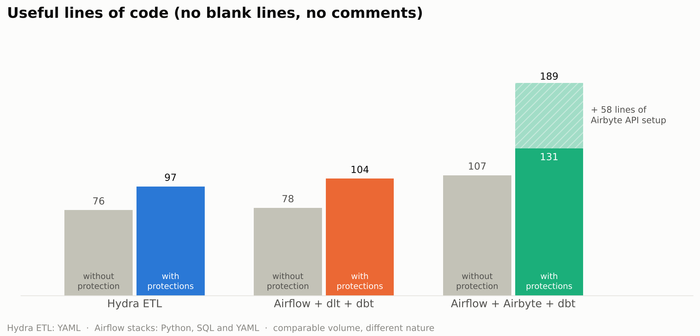

# Hydra ETL vs Airflow + dlt + dbt vs Airflow + Airbyte + dbt

The same small pipeline built three times, with the same four failures injected on purpose. This repository contains everything used for the comparison: the three implementations, the scripts that run and measure them, the raw results and logs, and the script that draws the charts.

Article: *Same guarantees, without programming them* (link added after publication).

## The pipeline

- **Input**: 200,000 orders and 2,000 customers (CSV, generated with a fixed seed by `shared/make_data.py`).
- **Work**: keep paid orders, join customers, compute revenue by country and revenue by month.
- **Output**: `output/revenue_by_country.csv` and `output/revenue_by_month.csv`.
- **Backup**: yesterday's export (`data/backup/orders.csv`, 199,000 orders), to use if today's data is unusable.

Before every run, the outputs hold the day-before-yesterday's reports (198,000 orders). After the run, `shared/scenarios.py` recomputes each expected version with pandas, independently of the stacks, and reports where each output comes from: `main` (today), `backup`, `previous` (unchanged) or `other`.

| Scenario | What breaks |
|---|---|
| `normal` | nothing |
| `missing_source` | `data/orders.csv` is missing |
| `bad_amount` | one amount is `abc`: the first report fails |
| `bad_date` | one date is `2026-13-45`: only the second report fails |

Each stack has two variants:

- **simple** (without protection): what you usually write first.
- **safe** (with protections): fallback to the backup when the source is missing or a step fails, both outputs published all-or-nothing, timeouts.

## Results









Raw numbers: `results/phase*/` (`install.json`, `scenarios_simple.json`, `scenarios_safe.json`, `lines_*.txt`), `results/phase3_airflow_airbyte_dbt/extra.json`, `results/machine.json`, `results/metrics.csv` (memory and CPU every second), `results/logs/` (one log per step; Airbyte credentials and private IPs redacted). `results/raw-report.md` is the report generated at the end of the run.

Redraw the charts:

```bash
pip install matplotlib
python charts/make_charts.py results charts
```

## Layout

| Folder | Content |
|---|---|
| `hydra/`, `hydra_simple/` | Hydra ETL project, safe and simple variants (YAML only) |
| `modern/` | Airflow DAGs + dlt ingestion + dbt models (DuckDB) |
| `airbyte/` | Airflow DAGs + Airbyte sync and setup scripts + dbt models (PostgreSQL) |
| `shared/` | data generator, failure scenarios, line counter, report |
| `run.py` | runs every phase with confirmations, progress and resume points |
| `volume/` | separate volume test (200,000 to 20 million rows, without Airflow) |
| `charts/` | charts and the script that draws them |

Lines are counted by `shared/count_lines.py`: useful lines only, without blank lines or comments.

## Reproduce

On a fresh Ubuntu 24.04 machine (the test used an AWS EC2 instance with 4 vCPUs, 15 GB of RAM and about 60 GB of free disk; Airbyte alone needs about 9 GB of Docker images):

```bash
git clone https://github.com/bejaouibechir/hydra-etl-benchmark.git
cd hydra-etl-benchmark
python3 run.py              # every phase, with a confirmation before each important step
python3 run.py --phase 1    # one phase: 0 setup, 1 Hydra ETL, 2 Airflow + dlt + dbt, 3 Airflow + Airbyte + dbt, 4 report
python3 run.py --status     # where the run stands
```

`run.py` only uses the Python standard library. Each stack is installed in its own virtual environment under `~/bench-envs/`. A failed step can be resumed: `python3 run.py` restarts at the failed step after cleaning it.

To replay only the four failures on Hydra ETL with the latest release:

```bash
python3 -m venv ~/hv && ~/hv/bin/pip install hydra-etl pandas
~/hv/bin/python shared/make_data.py shared/data
~/hv/bin/python shared/scenarios.py hydra "$HOME/hv/bin/hdrctl run ."
```

## Versions and limits

- Measured on October 28, 2026 with Hydra ETL 0.14.0, Airflow 3.3.2 and the dlt, dbt and Airbyte versions current that day (see `results/logs/`). The four failures were replayed with Hydra ETL 0.19.1 on November 5, 2026, with the same results.
- One machine, 200,000 rows.
- Three runs per scenario (median), one for Airbyte.
- Airflow runs use `airflow dags test`, which pays Airflow's start-up on every run; in production the scheduler runs continuously.
- Airbyte runs in `--low-resource-mode`, with its file source read over SFTP.
- The volume test in `volume/` ran on a different machine (2 vCPUs, 8 GB) with Hydra ETL 0.14.0, before its DuckDB engine (0.15).
- Code comments and console messages are in French.

Disclosure: the author of this benchmark is the author of Hydra ETL. If you see a flaw in the method, please open an issue.

## License

MIT
